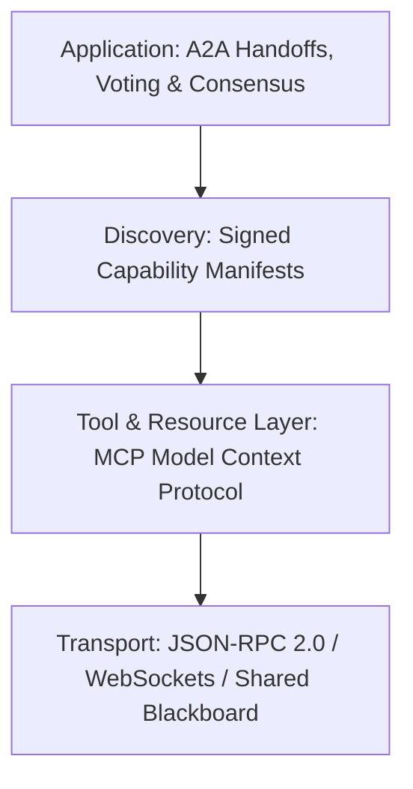

# Chapter 1: Transport & Discovery Protocols: A2A, ANP, MCP, and JSON-RPC 2.0

**Part of the textbook:** [Agent-to-Agent (A2A) Communications (2024–2026)](README.md)  
**Authoring Team:** Team 1 (Harness & Lifecycle)  
**Anchor Target:** `#chapter-1-a2a`

---

## 1.1 The Limitations of Unstructured Natural Language Messaging
Early multi-agent frameworks passed raw English prose between agents. This caused three systemic failures:
1. **Token Inflation:** Repeating context across $N$ agents scales as $O(N^2 \cdot L)$ where $L$ is average turn length.
2. **Parsing Fragility:** Downstream agents hallucinated when upstream agents varied Markdown or JSON formatting.
3. **Zero Provenance:** Natural language messages lacked sender authentication, timestamps, or cryptographic integrity.

## 1.2 The 2025–2026 Protocol Stack

## 1.3 Agent-to-Agent (A2A) & Agent Network Protocols (ANP)
- **Capability Advertisement:** Each agent publishes a signed manifest declaring its `role`, `model_sku`, `door_id`, `token_budget`, and `allowed_paths`.
- **Structured Task Dispatch:** Orchestrators send typed task payloads (`SPAWN_MANIFEST.json`) rather than open-ended prose.

## 1.4 Asynchronous Event Buses & Shared Message Boards
Modern swarms (e.g., COSMOS Clusters, AutoGen 0.4) decouple agents via asynchronous event buses or shared message boards:
- **Wake-on-Mention:** Sleeping agents cost zero tokens until an `@mention` or event triggers reactive wakeup.
- **Persistent Transcripts:** Every message is logged to an append-only JSONL transcript for replay ([Chapter 5](05_CHAPTER_5_ROUTING_BACKPRESSURE_OBSERVABILITY.md)).

---
**Next:** [Chapter 2: Semantic Handoffs, Schema Compression, and Intent Graphs](02_CHAPTER_2_SEMANTIC_HANDOFFS_AND_SCHEMAS.md) | **Index:** [Bibliography & Index](06_BIBLIOGRAPHY_AND_HYPERLINKED_INDEX.md)
