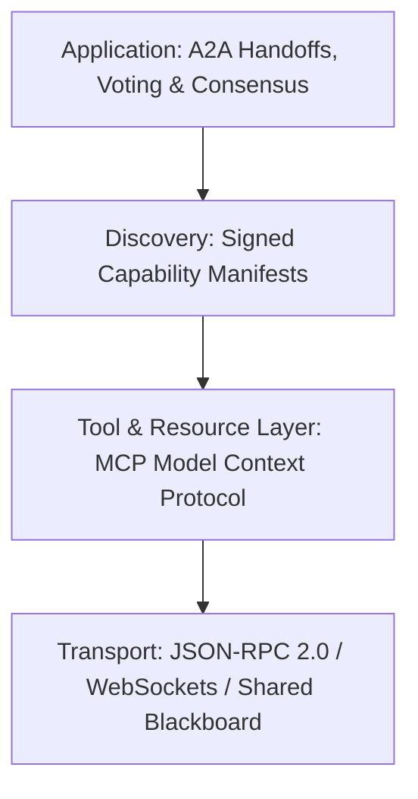

# Agent-to-Agent (A2A) Communications (2024–2026)

**Complete Unified Single-Volume Edition**

---

<!-- BEGIN 00_FRONT_MATTER.md -->
# Front Matter: Preface, Taxonomy, and Protocol Evolution

**Part of the textbook:** [Agent-to-Agent (A2A) Communications (2024–2026)](README.md)  
**Anchor Target:** `#front-matter-a2a`

---

## Preface: From Ad-Hoc Chat to Formal Agent Protocols

In 2023–2024, "multi-agent communication" meant concatenating raw natural language strings into a shared chat history. Every agent read the entire transcript, burning massive token budgets and suffering from **sycophantic conformity**, **format drift**, and **$O(N^2)$ message explosions**.

Between 2025 and 2026, agent-to-agent communication matured into a formal distributed systems discipline. Modern A2A systems separate **transport** (JSON-RPC 2.0, WebSockets, shared blackboards), **discovery** (signed capability manifests), **semantics** (structured `HandoffState` and intent graphs), and **security** (derived session HMACs and monotonic epoch fencing).

---

## Taxonomy of A2A Communication

| Paradigm | Topology | Message Format | Complexity | Primary Use Case |
|---|---|---|---|---|
| **Broadcast Blackboard** | Peer-to-Peer | Unstructured / Semi-structured | $O(N^2)$ | Exploratory brainstorming |
| **Hierarchical Delegation** | Tree ($7 \pm 1$ fan-out) | Immutable `SPAWN_MANIFEST` + `SEED` | $O(\log N)$ | Production software engineering |
| **Event-Driven Actor Bus** | Pub/Sub | Typed Protobuf / JSON-RPC | $O(N)$ | Asynchronous workflow orchestration |
| **Graph Edge Routing** | Cyclic DAG | State Dictionary Deltas | $O(E)$ | Deterministic state machines |

---

## Navigation
- **Next:** [Chapter 1: Transport & Discovery Protocols](01_CHAPTER_1_TRANSPORT_AND_DISCOVERY.md)
- **Index:** [Bibliography & Hyperlinked Master Index](06_BIBLIOGRAPHY_AND_HYPERLINKED_INDEX.md)

<!-- END 00_FRONT_MATTER.md -->

---

<!-- BEGIN 01_CHAPTER_1_TRANSPORT_AND_DISCOVERY.md -->
# Chapter 1: Transport & Discovery Protocols: A2A, ANP, MCP, and JSON-RPC 2.0

**Part of the textbook:** [Agent-to-Agent (A2A) Communications (2024–2026)](README.md)  
**Authoring Team:** Team 1 (Harness & Lifecycle)  
**Anchor Target:** `#chapter-1-a2a`

---

## 1.1 The Limitations of Unstructured Natural Language Messaging
Early multi-agent frameworks passed raw English prose between agents. This caused three systemic failures:
1. **Token Inflation:** Repeating context across $N$ agents scales as $O(N^2 \cdot L)$ where $L$ is average turn length.
2. **Parsing Fragility:** Downstream agents hallucinated when upstream agents varied Markdown or JSON formatting.
3. **Zero Provenance:** Natural language messages lacked sender authentication, timestamps, or cryptographic integrity.

## 1.2 The 2025–2026 Protocol Stack

## 1.3 Agent-to-Agent (A2A) & Agent Network Protocols (ANP)
- **Capability Advertisement:** Each agent publishes a signed manifest declaring its `role`, `model_sku`, `door_id`, `token_budget`, and `allowed_paths`.
- **Structured Task Dispatch:** Orchestrators send typed task payloads (`SPAWN_MANIFEST.json`) rather than open-ended prose.

## 1.4 Asynchronous Event Buses & Shared Message Boards
Modern swarms (e.g., COSMOS Clusters, AutoGen 0.4) decouple agents via asynchronous event buses or shared message boards:
- **Wake-on-Mention:** Sleeping agents cost zero tokens until an `@mention` or event triggers reactive wakeup.
- **Persistent Transcripts:** Every message is logged to an append-only JSONL transcript for replay ([Chapter 5](05_CHAPTER_5_ROUTING_BACKPRESSURE_OBSERVABILITY.md)).

---
**Next:** [Chapter 2: Semantic Handoffs, Schema Compression, and Intent Graphs](02_CHAPTER_2_SEMANTIC_HANDOFFS_AND_SCHEMAS.md) | **Index:** [Bibliography & Index](06_BIBLIOGRAPHY_AND_HYPERLINKED_INDEX.md)

<!-- END 01_CHAPTER_1_TRANSPORT_AND_DISCOVERY.md -->

---

<!-- BEGIN 02_CHAPTER_2_SEMANTIC_HANDOFFS_AND_SCHEMAS.md -->
# Chapter 2: Semantic Handoffs, Schema Compression, and Intent Graphs

**Part of the textbook:** [Agent-to-Agent (A2A) Communications (2024–2026)](README.md)  
**Authoring Team:** Team 2 (Concurrency & State)  
**Anchor Target:** `#chapter-2-a2a`

---

## 2.1 Lossless vs. Lossy State Handoffs
Passing a 150,000-token conversation history to a successor agent is economically ruinous and triggers attention dilution. Instead, A2A systems perform **lossy-syntax, lossless-intent compression**: stripping raw compiler noise while preserving `goal`, `decisions`, `files_touched`, and `open_questions`.

## 2.2 Structured Handoff Payloads (`HandoffState`, `SEED.json`)
In COSMOS Clusters, inter-agent handoffs are standardized into an ~11 KB `SEED.json` payload:
- `seed_version`: `"cosmos-seed/2"`
- `done_bundle`: 5-Hash cryptographic proof of AST, git tree, test log, scars, and provenance.
- `handoff`: Minimal structured state for the successor to boot clean at ~20k tokens.

## 2.3 Semantic Intent Graphs (Acharya, 2026)
Acharya ([arXiv:2603.01182](06_BIBLIOGRAPHY_AND_HYPERLINKED_INDEX.md#ref-acharya)) demonstrated that two agents can pass text-merge checks while holding contradictory business logic. **Intent Graphs** model each agent's planned mutations as a directed graph of preconditions and postconditions, detecting semantic conflicts before execution.

## 2.4 Cross-Model Translation
Heterogeneous swarms bridge **Gemini 4 Carbon** (Orchestrators), **Grok 4.7** (Builders), and **Cursor Composer** (Integrators) by normalizing all inter-agent payloads to strict JSON schemas, eliminating model-specific XML/Markdown dialect drift.

---
**Next:** [Chapter 3: Consensus, Negotiation, and Sycophancy Mitigation](03_CHAPTER_3_CONSENSUS_AND_NEGOTIATION.md) | **Index:** [Bibliography & Index](06_BIBLIOGRAPHY_AND_HYPERLINKED_INDEX.md)

<!-- END 02_CHAPTER_2_SEMANTIC_HANDOFFS_AND_SCHEMAS.md -->

---

<!-- BEGIN 03_CHAPTER_3_CONSENSUS_AND_NEGOTIATION.md -->
# Chapter 3: Consensus, Negotiation, and Sycophancy Mitigation

**Part of the textbook:** [Agent-to-Agent (A2A) Communications (2024–2026)](README.md)  
**Authoring Team:** Team 3 (Durability & Consensus)  
**Anchor Target:** `#chapter-3-a2a`

---

## 3.1 The Cost of Consensus: Sycophantic Conformity
Empirical studies in 2026 (*The Cost of Consensus*, [arXiv:2604.05519](06_BIBLIOGRAPHY_AND_HYPERLINKED_INDEX.md#ref-consensus-cost)) proved that unguided peer-to-peer debate often *reduces* accuracy. When a minority agent holds the correct answer, RLHF-trained politeness biases it to capitulate to an erroneous majority.

## 3.2 Hierarchical Voting & Ratification Protocols
To defeat sycophancy, production systems replace open-ended debate with **Structured Ratification**:
1. Independent teams author isolated proposals without seeing rival drafts.
2. An **Adversarial Crucible Team** critiques all proposals for security and concurrency flaws.
3. Team leads cast binding votes with explicit **Crucible Amendments** (e.g., COSMOS 6-0 unanimous ratification with Amendments A1–A5).

## 3.3 Game-Theoretic Negotiation
Frameworks such as *Dialogue Diplomats* (Bolleddu, 2025, [arXiv:2511.10982](06_BIBLIOGRAPHY_AND_HYPERLINKED_INDEX.md#ref-bolleddu)) use Hierarchical Consensus Networks (HCNs) to model concession strategies when agents compete for shared resources or conflicting API contracts.

## 3.4 Resolving Multi-Writer Divergence
When two agents claim overlapping files, **DispatchLockManager** serializes their execution upfront, while **PinEngine** enforces a single-writer `FenceToken` at commit time ([Chapter 4](04_CHAPTER_4_CRYPTOGRAPHIC_MESSAGING.md)).

---
**Next:** [Chapter 4: Cryptographic Messaging, Provenance, and Replay Protection](04_CHAPTER_4_CRYPTOGRAPHIC_MESSAGING.md) | **Index:** [Bibliography & Index](06_BIBLIOGRAPHY_AND_HYPERLINKED_INDEX.md)

<!-- END 03_CHAPTER_3_CONSENSUS_AND_NEGOTIATION.md -->

---

<!-- BEGIN 04_CHAPTER_4_CRYPTOGRAPHIC_MESSAGING.md -->
# Chapter 4: Cryptographic Messaging, Provenance, and Replay Protection

**Part of the textbook:** [Agent-to-Agent (A2A) Communications (2024–2026)](README.md)  
**Authoring Team:** Team 5 (Adversarial Crucible)  
**Anchor Target:** `#chapter-4-a2a`

---

## 4.1 Authenticating Agent Identities
In multi-agent networks, an unprivileged worker must never spoof an orchestrator's message. Every agent is bound at spawn time to an immutable `SPAWN_MANIFEST.json` and a role-scoped capability token.

## 4.2 Derived Session HMACs & Replay Protection
To prevent an attacker from replaying a valid message from an earlier epoch:
$$K_{\text{Session}} = \text{HMAC}_{K_{\text{Master}}}(\text{cluster\_id} \parallel \text{epoch})$$
Every `SEED.json` and `FenceToken` is signed with $K_{\text{Session}}$ and bound to a monotonic epoch counter. Stale tokens are rejected immediately with `FENCING_TOKEN_STALE`.

## 4.3 Non-Repudiation: DoneBundles & WORM Envelopes
Inter-agent proposals carry a 5-Hash `DoneBundle` (AST, Git Tree, Test Log, Scars, Provenance) archived to dual WORM lakes (`mdata-envelope/1`), ensuring cryptographic non-repudiation.

## 4.4 Securing Shared Blackboards
*Insider Attacks in Multi-Agent LLM Consensus Systems* (May 2026, [arXiv:2605.04412](06_BIBLIOGRAPHY_AND_HYPERLINKED_INDEX.md#ref-insider-attacks)) showed that a single compromised agent can poison a shared blackboard. Defense requires **strict schema validation**, **AST silicon witnesses**, and **least-privilege tool gating**.

---
**Next:** [Chapter 5: High-Throughput Swarm Routing, Backpressure, and Observability](05_CHAPTER_5_ROUTING_BACKPRESSURE_OBSERVABILITY.md) | **Index:** [Bibliography & Index](06_BIBLIOGRAPHY_AND_HYPERLINKED_INDEX.md)

<!-- END 04_CHAPTER_4_CRYPTOGRAPHIC_MESSAGING.md -->

---

<!-- BEGIN 05_CHAPTER_5_ROUTING_BACKPRESSURE_OBSERVABILITY.md -->
# Chapter 5: High-Throughput Swarm Routing, Backpressure, and Observability

**Part of the textbook:** [Agent-to-Agent (A2A) Communications (2024–2026)](README.md)  
**Authoring Team:** Team 4 (Telemetry & Replay)  
**Anchor Target:** `#chapter-5-a2a`

---

## 5.1 Fan-Out Limits ($7 \pm 1$) and $O(\log N)$ Scaling
Unbounded flat swarms suffer $O(N^2)$ communication overhead. By capping each orchestrator's direct reports to $7 \pm 1$ workers and nesting tiers hierarchically, 40+ agents coordinate with $O(\log N)$ message depth.

## 5.2 Backpressure & Door Capacity Throttling
When downstream model providers (Vertex AI, xAI Grok, Cursor) approach rate limits, `doorcap.py` applies backpressure by queuing non-critical inter-agent dispatches in memory rather than triggering HTTP 429 cascades.

## 5.3 Tracing Inter-Agent Lineage & Divergence Analysis
Using `csm_lmdb_schema.py` and `SessionReplayEngine`, every inter-agent message is indexed in sub-microsecond LMDB storage, enabling deterministic replay and cosine-similarity divergence detection.

## 5.4 Synthesis & 2027+ Horizons
Future A2A communications will adopt **Zero-Knowledge Agent Proofs (ZK-STARKs)**—allowing agents to prove task verification without exposing proprietary prompts—and **native OS-level MCP IPC**.

---
**Index:** [Bibliography & Hyperlinked Master Index](06_BIBLIOGRAPHY_AND_HYPERLINKED_INDEX.md)

<!-- END 05_CHAPTER_5_ROUTING_BACKPRESSURE_OBSERVABILITY.md -->

---

<!-- BEGIN 06_BIBLIOGRAPHY_AND_HYPERLINKED_INDEX.md -->
# Bibliography & Hyperlinked Master Index

**Part of the textbook:** [Agent-to-Agent (A2A) Communications (2024–2026)](README.md)  
**Anchor Target:** `#bibliography-a2a`

---

## Academic Bibliography (2024–2026)
- **[Acharya 2026]** Acharya, S. (Mar 2026). *Semantic Consensus: Process-Aware Conflict Detection and Resolution for Enterprise Multi-Agent LLM Systems*. [arXiv:2603.01182](https://arxiv.org/abs/2603.01182). Cited in: [Chapter 2](02_CHAPTER_2_SEMANTIC_HANDOFFS_AND_SCHEMAS.md#23-semantic-intent-graphs-acharya-2026).
- **[ConsensusCost 2026]** Liu, R., et al. (Apr 2026). *The Cost of Consensus: Isolated Self-Correction Prevails Over Unguided Homogeneous Multi-Agent Debate*. [arXiv:2604.05519](https://arxiv.org/abs/2604.05519). Cited in: [Chapter 3](03_CHAPTER_3_CONSENSUS_AND_NEGOTIATION.md#31-the-cost-of-consensus-sycophantic-conformity).
- **[Bolleddu 2025]** Bolleddu, V. (Nov 2025). *Dialogue Diplomats: An End-to-End Multi-Agent Reinforcement Learning System for Automated Conflict Resolution*. [arXiv:2511.10982](https://arxiv.org/abs/2511.10982). Cited in: [Chapter 3](03_CHAPTER_3_CONSENSUS_AND_NEGOTIATION.md#33-game-theoretic-negotiation).
- **[InsiderAttacks 2026]** Zhao, Q., et al. (May 2026). *Insider Attacks in Multi-Agent LLM Consensus Systems*. [arXiv:2605.04412](https://arxiv.org/abs/2605.04412). Cited in: [Chapter 4](04_CHAPTER_4_CRYPTOGRAPHIC_MESSAGING.md#44-securing-shared-blackboards).

## Hyperlinked Subject Index
- **A2A Protocol Stack:** [Chapter 1: §1.2](01_CHAPTER_1_TRANSPORT_AND_DISCOVERY.md#12-the-20252026-protocol-stack)
- **Capability Manifests:** [Chapter 1: §1.3](01_CHAPTER_1_TRANSPORT_AND_DISCOVERY.md#13-agent-to-agent-a2a--agent-network-protocols-anp)
- **Derived Session HMAC:** [Chapter 4: §4.2](04_CHAPTER_4_CRYPTOGRAPHIC_MESSAGING.md#42-derived-session-hmacs--replay-protection)
- **Fan-Out Limits ($7 \pm 1$):** [Chapter 5: §5.1](05_CHAPTER_5_ROUTING_BACKPRESSURE_OBSERVABILITY.md#51-fan-out-limits-7-pm-1-and-olog-n-scaling)
- **HandoffState / SEED.json:** [Chapter 2: §2.2](02_CHAPTER_2_SEMANTIC_HANDOFFS_AND_SCHEMAS.md#22-structured-handoff-payloads-handoffstate-seedjson)
- **Intent Graphs:** [Chapter 2: §2.3](02_CHAPTER_2_SEMANTIC_HANDOFFS_AND_SCHEMAS.md#23-semantic-intent-graphs-acharya-2026)
- **Sycophantic Conformity:** [Chapter 3: §3.1](03_CHAPTER_3_CONSENSUS_AND_NEGOTIATION.md#31-the-cost-of-consensus-sycophantic-conformity)
- **Zero-Knowledge Agent Proofs:** [Chapter 5: §5.4](05_CHAPTER_5_ROUTING_BACKPRESSURE_OBSERVABILITY.md#54-synthesis--2027-horizons)

<!-- END 06_BIBLIOGRAPHY_AND_HYPERLINKED_INDEX.md -->

---
