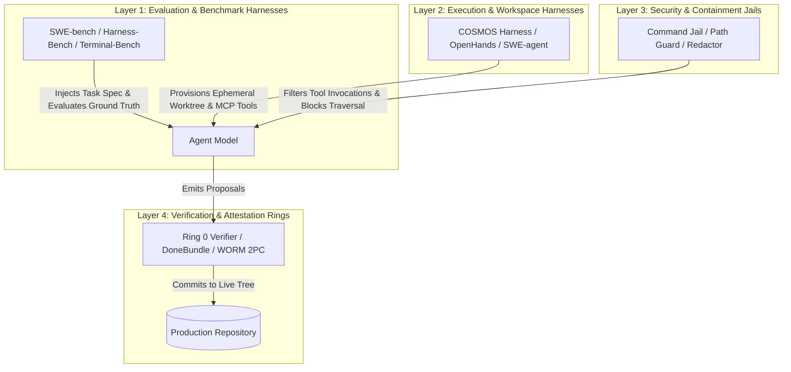

# Front Matter: Preface, The Harness Paradigm, and 2024–2026 Evolution

**Part of the textbook:** [Frontier Agent Harnesses (2024–2026)](README.md)  
**Authors:** COSMOS Multi-Agent Research Consortium (Teams 1–5)  
**Anchor Target:** `#front-matter`

---

## Table of Contents
- [Preface: The Harness Paradigm Shift](#preface-the-harness-paradigm-shift)
- [Taxonomy of Modern Agent Harnesses](#taxonomy-of-modern-agent-harnesses)
- [Chronological Timeline of Harness Engineering (2024–2026)](#chronological-timeline-of-harness-engineering-20242026)
- [The Dual-Volume Architecture: MAS & Harnesses](#the-dual-volume-architecture-mas--harnesses)
- [Book Navigation](#book-navigation)

---

## Preface: The Harness Paradigm Shift

During the initial expansion of generative AI (2022–2024), the prevailing industry narrative focused almost exclusively on base foundation model capabilities. Benchmarks such as MMLU and HumanEval evaluated models in artificial, zero-shot environments. 

However, as organizations attempted to deploy autonomous coding, security, and infrastructure agents into production, a startling divergence emerged: **two deployments utilizing the exact same underlying model weights routinely exhibited wildly disparate real-world performance, varying from 15% to 75% on identical complex software tasks**.

The definitive explanation for this discrepancy was codified between 2025 and 2026:
> **"The model is not the agent. The model is merely the CPU; the harness is the operating system."**  
> — *Stop Comparing LLM Agents Without Disclosing the Harness* (2025/2026)

An **Agent Harness** is the multi-layered runtime substrate that wraps around a foundation model to transform raw probabilistic next-token generation into safe, reproducible, and verifiable computation. The harness is responsible for:
1. **Workspace Sandboxing:** Managing ephemeral execution environments, preventing host corruption, and jailing dangerous commands ([Chapter 2](02_CHAPTER_2_SANDBOXING_CONTAINMENT_AND_WORKSPACES.md)).
2. **Context & Quota Governance:** Enforcing token ceilings, managing tool definitions, and preventing financial burnouts via proactive session rotation ([Chapter 3](03_CHAPTER_3_ROUTING_FAILOVER_AND_DOOR_ALLOCATION.md)).
3. **Deterministic Evaluation Oracles:** Replacing unreliable "LLM-as-a-Judge" prompts with compiler AST verifiers and local test suites ([Chapter 4](04_CHAPTER_4_EVALUATION_ORACLES_AND_GROUND_TRUTH.md)).
4. **Ring 0 Verification & Self-Healing:** Enforcing cryptographic admission gates, learning from operational scars, and writing immutable WORM lake records ([Chapter 5](05_CHAPTER_5_VERIFICATION_SCARS_AND_WORM_ATTESTATION.md)).

Without an engineered harness, an LLM is a volatile stochastic generator. Wrapped in a resilient harness, an LLM becomes an industrial autonomous agent.

---

## Taxonomy of Modern Agent Harnesses

Modern agent harnesses are classified into four architectural categories:



| Harness Class | Primary Objective | Key Mechanisms | Exemplars |
|---|---|---|---|
| **Class 1: Evaluation & Benchmark** | Measures agent capabilities reproducibly under strict constraints. | Frozen docker containers, ground truth oracle test suites, test-time compute accounting. | SWE-harness, Harness-Bench, Terminal-Bench, Inspect AI |
| **Class 2: Execution & Runtime** | Provides the interactive operational substrate for real-world tasks. | Ephemeral git worktrees, MCP tool routing, event-driven state machines, prompt injection. | **COSMOS Harness v6.0.0**, OpenHands, Claude Code, Cursor |
| **Class 3: Containment & Jailing** | Restricts model capabilities to prevent host attacks and data leaks. | Path normalization, symlink guards, secret redaction, parameter flag filtering. | `jail.py`, `lsp_guard.py`, Docker / Firecracker microVMs |
| **Class 4: Verification & Attestation** | Certifies code correctness and creates tamper-proof audit trails. | 5-Hash DoneBundles, deterministic AST witnesses, Ring 0 cryptographic leases, 2PC WORM lakes. | `ring0_verifier.py`, `mdata_emitter.py`, `worm_2pc.py` |

---

## Chronological Timeline of Harness Engineering (2024–2026)

- **Q4 2024:**
  - Standardized benchmark harnesses (SWE-bench / SWE-harness) demonstrate that prompt formatting and shell interaction loops account for >30% score variance across identical models.
  - Anthropic releases Model Context Protocol (MCP); harnesses transition from hard-coded Python scripts to dynamic RPC-based tool servers.
- **Q1–Q2 2025:**
  - *UK AI Safety Institute (AISI)* releases *Inspect AI*, formalizing evaluation harness architectures for frontier model safety evaluations.
  - OpenHands and SWE-agent pioneer specialized bash/edit tool harnesses with custom linting and interactive diagnostic feedback.
  - The "Sycophantic Judge" crisis: Studies prove that LLM-based evaluation harnesses routinely score their own model outputs 20–40% higher than rival models, driving the industry toward deterministic compiler oracles.
- **Q3–Q4 2025:**
  - *Harness-Bench* established as the first diagnostic benchmark explicitly testing harness configuration effects (prompt templates, tool formatting, git state management) under matched compute budgets.
  - *Keith Harness Specifications (COSMOS Harness v6.0.0):* Introduction of Ring 0 verifiers, 5-hash DoneBundles, and the Scar Tissue failure-learning protocol.
- **Q1–Q2 2026:**
  - Publication of *Stop Comparing LLM Agents Without Disclosing the Harness* ([arXiv:2602.xxxxx](06_BIBLIOGRAPHY_AND_HYPERLINKED_INDEX.md#ref-disclose-harness)): Formal recognition that model evaluations without harness transparency are scientifically invalid.
  - Integration of Language Server Protocol (LSP) guards inside agent execution harnesses (`lsp_guard.py`), providing instant type-checking and syntax error feedback before tool returns reach the model.
- **Q3–Q4 2026:**
  - Production deployment of Dual-Target Two-Phase Commit WORM lake attestation harnesses (`mdata-envelope/1`).
  - COSMOS Clusters v0.2.0 and COSMOS Harness v6.0.0 achieve seamless Ring 0 companion integration, executing 328/328 verified test passes under zero human intervention.

---

## The Dual-Volume Architecture: MAS & Harnesses

This volume forms an integrated companion to *Frontier Multi-Agent Systems*:

```
+---------------------------------------------------------------------------------------+
|                    VOLUME 1: FRONTIER MULTI-AGENT SYSTEMS (MAS)                       |
| Topologies | Concurrency & Ephemeral Worktrees | Durability Triad | Crucible Chaos   |
+---------------------------------------------------------------------------------------+
                                           |
                                  RUNS DIRECTLY UPON
                                           v
+---------------------------------------------------------------------------------------+
|                       VOLUME 2: FRONTIER AGENT HARNESSES                              |
| Runtime Substrate | Command Jails | Model Routing & Failover | Oracles | Ring 0 WORM |
+---------------------------------------------------------------------------------------+
```

---

## Book Navigation
- **Next:** [Chapter 1: Anatomy of an Agent Harness: The Execution Substrate Beyond the LLM](01_CHAPTER_1_HARNESS_FOUNDATIONS_AND_ARCHITECTURE.md)
- **Jump to:**
  - [Chapter 2: Workspace Containment, Sandboxing, and Jail Architectures](02_CHAPTER_2_SANDBOXING_CONTAINMENT_AND_WORKSPACES.md)
  - [Chapter 3: Model Routing, Deterministic Failover, and Door Allocation](03_CHAPTER_3_ROUTING_FAILOVER_AND_DOOR_ALLOCATION.md)
  - [Chapter 4: Evaluation Harnesses, Benchmarks, and Oracle Verification](04_CHAPTER_4_EVALUATION_ORACLES_AND_GROUND_TRUTH.md)
  - [Chapter 5: Ring 0 Cryptographic Verification, Scar Tissue, and WORM Attestation](05_CHAPTER_5_VERIFICATION_SCARS_AND_WORM_ATTESTATION.md)
  - [Master Bibliography & Hyperlinked Index](06_BIBLIOGRAPHY_AND_HYPERLINKED_INDEX.md)
