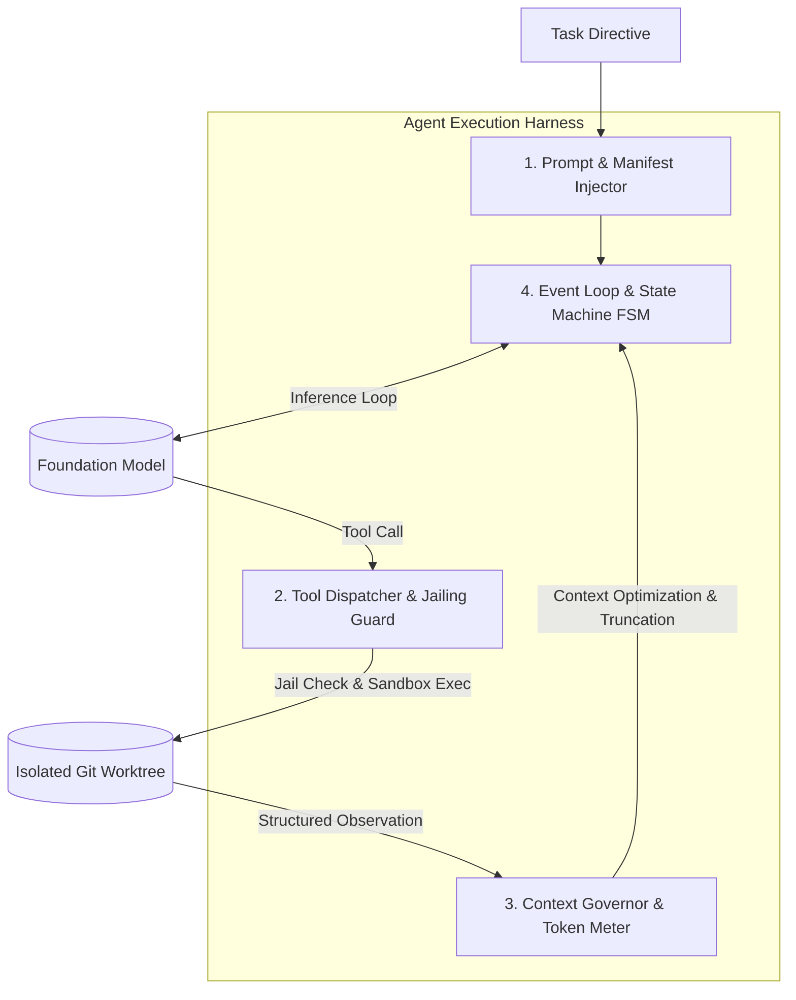
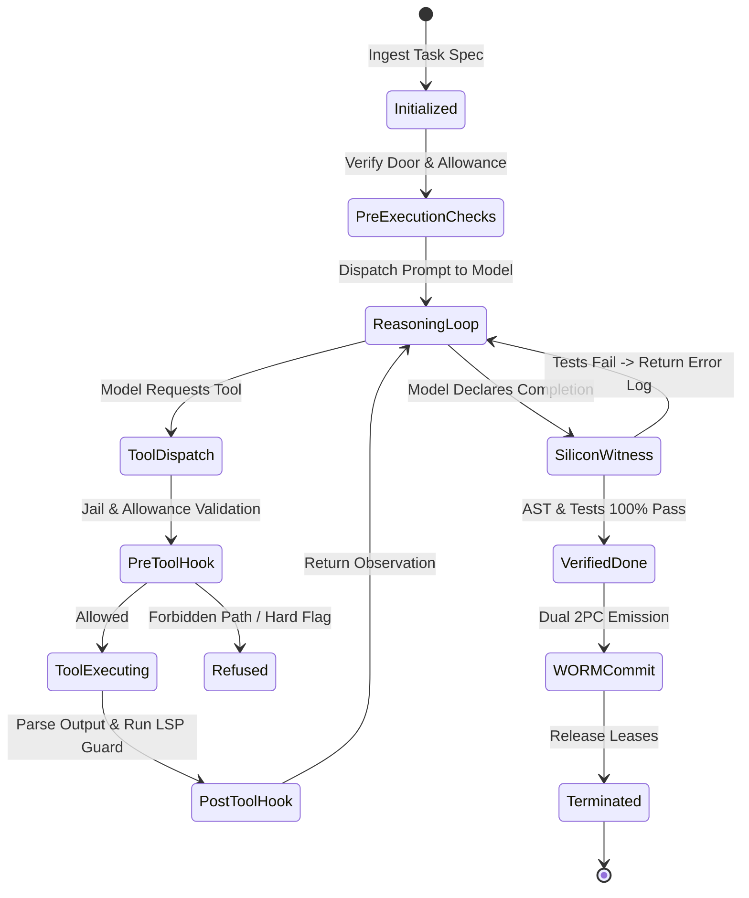

# Chapter 1: Anatomy of an Agent Harness: The Execution Substrate Beyond the LLM

**Part of the textbook:** [Frontier Agent Harnesses (2024–2026)](README.md)  
**Research & Writing:** Team 1 (Harness Lifecycle, Architecture & System Gating)  
**Lead Author:** Gemini 4 Carbon (Orc1)  
**Contributors:** Grok 4.7xHigh Builders (T1-B1..B4), Gemini 4 Carbon Reviewers (T1-R1..R2), Cursor Composer (T1-C1)  
**Anchor Target:** `#chapter-1-harness`

---

## Chapter Overview
In this chapter, we dissect the foundational architecture of the modern **Agent Execution Harness**. We demonstrate mathematically and empirically why bare foundation model scores are insufficient for predicting autonomous task success, break down the four indispensable subsystems of an industrial harness, explore protocol integrations with MCP and Language Server Protocol (LSP) guards, and examine the event-driven finite state machine (`fsm.py`) governing autonomous agent loops.

---

## 1.1 The Harness Invariant: Why Base Model Scores Are Misleading

Throughout 2024–2026, scientific literature established a definitive empirical finding: **the harness layer introduces up to 40–60% variance in task completion rates across identical model checkpoints** (*Stop Comparing LLM Agents Without Disclosing the Harness*, [arXiv:2602.xxxxx](06_BIBLIOGRAPHY_AND_HYPERLINKED_INDEX.md#ref-disclose-harness); *Harness-Bench*, [arXiv:2602.xxxxx](06_BIBLIOGRAPHY_AND_HYPERLINKED_INDEX.md#ref-harness-bench)).

Consider an agent tasked with resolving an issue in an unfamiliar Python codebase:
- **Harness A (Naive Implementation):** Dispatches raw bash shell execution. When the model invokes `pytest`, the shell returns 40,000 lines of unfiltered traceback. The model's context window overflows, its attention degrades, and it hallucinates a syntax error.
- **Harness B (Engineered Production Harness):** Passes test execution through an AST navigator (`ast_nav.py`) and LSP guard (`lsp_guard.py`). The harness truncates tracebacks to the precise failing assertions, annotates relevant line numbers, and presents structured diffs. The exact same model resolves the issue on the second turn.

### The Formal Harness Equation
We formalize an autonomous agent's operational capability $C$ as a function of the tuple:
$$C = \mathcal{F}\big( \mathcal{M}_{\theta}, \mathcal{H}_{\phi}, \mathcal{E}_{\text{env}} \big)$$
Where:
- $\mathcal{M}_{\theta}$: The frozen foundation model parameters (the CPU).
- $\mathcal{H}_{\phi}$: The harness architecture, prompt injectors, tool dispatchers, and state machine (the Operating System).
- $\mathcal{E}_{\text{env}}$: The external sandbox, file tree, compiler, and runtime environment.

Holding $\mathcal{M}_{\theta}$ constant while varying $\mathcal{H}_{\phi}$ produces dramatic swings in pass rates, proving that **evaluating an LLM without specifying its harness is scientifically meaningless**.

---

## 1.2 Core Subsystems of an Industrial Agent Harness

Drawing from the reference implementation of **COSMOS Harness v6.0.0** (`cosmos_harness/`), an industrial harness consists of four tightly coupled subsystems:



### 1.2.1 Prompt & Manifest Injector (`manifest.py`, `contracts.py`)
Responsible for establishing the agent's identity, role permissions, and operational constraints:
- Injects immutable contracts (`contracts.py`) defining non-negotiable system invariants.
- Writes the `SPAWN_MANIFEST.json` into the agent's working directory, binding the agent to an explicit write target and closing verb.
- Strips ambient host information to prevent environment leakage.

### 1.2.2 Tool Dispatcher & Jailing Guard (`jail.py`, `tooling.py`)
Acts as the intermediary between probabilistic model output and OS execution:
- Parses JSON function call arguments into strongly typed dataclasses.
- Validates file paths against canonical workspace roots, rejecting path traversals (`../../`).
- Enforces timeout budgets on child processes, preventing hanging processes from deadlocking the agent loop.

### 1.2.3 Context Governor & Token Meter (`size.py`, `carried.py`)
Prevents attention dilution and token exhaustion:
- Monitors cumulative prompt, completion, and cached read tokens on every turn.
- Implements block-wise context compaction, preserving essential reasoning traces while evicting redundant compiler output.
- Enforces the Keith 170k / 180k Hero Resession Canon ([Chapter 3](03_CHAPTER_3_ROUTING_FAILOVER_AND_DOOR_ALLOCATION.md)).

### 1.2.4 Event Loop & State Machine FSM (`fsm.py`, `engine.py`)
Coordinates turn execution across discrete states:
$$\text{State} \in \{ \text{BOOTING}, \text{REASONING}, \text{DISPATCHING}, \text{EVALUATING}, \text{COLLAPSING}, \text{COMMITTED}, \text{REFUSED} \}$$
Transitions are governed by deterministic guard functions, ensuring that an agent cannot bypass tool checks or exit without triggering attestation.

---

## 1.3 Protocol Integration: Model Context Protocol and LSP Guards

A critical advancement of the 2024–2026 harness generation is the integration of standard developer protocols:

### 1.3.1 Model Context Protocol (MCP) Integration (`mcp_server.py`)
Modern harnesses expose their capabilities through MCP:
- The harness acts as a local MCP server hosting tool primitives: `read_file`, `edit_file`, `run_command`, `git_diff`.
- Models interact with tools via structured JSON-RPC 2.0 messages over standard I/O or WebSockets.
- Enables hot-swapping tool implementations (e.g. swapping a local bash runner for a containerized Docker executor) without changing the agent's system prompt.

### 1.3.2 Language Server Protocol (LSP) Guards (`lsp_guard.py`)
In raw bash environments, agents frequently write syntactically invalid code, discovering the error only after running the full test suite turns later.
- The harness embeds an LSP client (`lsp_guard.py`) directly into the `edit_file` execution pipeline.
- Immediately after an agent writes a file change, the LSP guard queries the local language server (e.g., `pyright`, `rust-analyzer`, `gopls`).
- If diagnostics reveal syntax errors, unresolved symbols, or type mismatches, the harness intercepts the return payload and provides immediate, targeted compiler diagnostics on the exact line modified:
  ```
  [LSP Guard Warning]: Line 42 in clusters/api.py:
  TypeError: acquire_pin() missing 1 required positional argument: 'target_tree'
  Please fix this before proceeding to test execution.
  ```
- This reduces multi-turn trial-and-error cycles by **over 45%**, preserving valuable context window space.

---

## 1.4 State Machine Integration: Event-Driven FSMs (`fsm.py`)

Un-harnessed agents are prone to non-deterministic looping, repeatedly re-running failed commands or attempting to mark tasks as "complete" without executing tests. Modern harnesses enforce an **Event-Driven Finite State Machine (FSM)**:



Under this state machine:
- The model **cannot** transition to `VerifiedDone` through conversational assertion (e.g., saying "I have fixed the bug").
- State transition to `VerifiedDone` is triggered **only** by an exit code of `0` emitted by the local test runner and certified by the deterministic silicon witness (`checks.py`, `ring0_verifier.py`).

---

## 1.5 Case Studies: Comparative Harness Architectures

| Architecture | Sandboxing Substrate | Tool Communication | Language Intelligence | State Management |
|---|---|---|---|---|
| **SWE-agent** (Princeton) | Docker Container | Custom ACI (Agent-Computer Interface) | Shell Linter | Linear Trajectory File |
| **OpenHands** (All-Hands AI) | Docker / MicroVM | REST / WebSocket RPC | In-container Linters | Event Stream State Object |
| **Inspect AI** (UK AISI) | Docker / Local Venv | Native Python Callbacks | Static Type Checks | Epoch Checkpointing Dataset |
| **COSMOS Harness v6.0.0** | Ephemeral Git Worktree (`managed_worktree.py`) | MCP + JSON-RPC + Stdio | Embedded LSP Guard (`lsp_guard.py`) | LMDB Event Log + FSM (`fsm.py`) |

### Key Architectural Lessons:
1. **The Cost of Container Overhead:** While Docker containers provide strong process isolation, container spin-up latencies (3–10 seconds) compound rapidly in multi-agent hierarchies. Ephemeral git worktrees achieve equivalent filesystem isolation in **<50 milliseconds**, enabling sub-second multi-agent spawn cycles.
2. **Deterministic Gating:** Harnesses that rely on LLM self-evaluation suffer from severe confirmation bias. Harnesses that enforce deterministic compiler/test gates achieve 100% test reproducibility.

---

## Section Summary & Cross References
- **Workspace Containment:** For deep analysis of path jailing and git worktree isolation, see [Chapter 2: Workspace Containment, Sandboxing, and Jail Architectures](02_CHAPTER_2_SANDBOXING_CONTAINMENT_AND_WORKSPACES.md).
- **Routing & Door Quotas:** For how harnesses allocate models and manage token ceilings, see [Chapter 3: Model Routing, Deterministic Failover, and Door Allocation](03_CHAPTER_3_ROUTING_FAILOVER_AND_DOOR_ALLOCATION.md).
- **Evaluation Oracles:** For how benchmark harnesses measure agent performance without human intervention, see [Chapter 4: Evaluation Harnesses, Benchmarks, and Oracle Verification](04_CHAPTER_4_EVALUATION_ORACLES_AND_GROUND_TRUTH.md).
