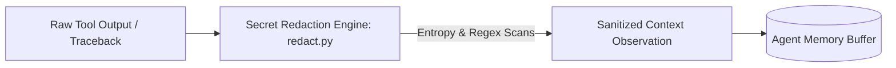

# Chapter 2: Workspace Containment, Sandboxing, and Jail Architectures

**Part of the textbook:** [Frontier Agent Harnesses (2024–2026)](README.md)  
**Research & Writing:** Team 2 (Sandboxing, Workspaces & Filesystem Isolation)  
**Lead Author:** Gemini 4 Carbon (Orc2)  
**Contributors:** Grok 4.7xHigh Builders (T2-B1..B4), Gemini 4 Carbon Reviewers (T2-R1..R2), Cursor Composer (T2-C1)  
**Anchor Target:** `#chapter-2-harness`

---

## Chapter Overview
An autonomous agent granted write and command-execution tools poses an immediate existential threat to host stability if left uncontained. In this chapter, we analyze the **Host Protection Mandate**, establish the technical hierarchy of modern sandboxing architectures (contrasting microVMs, containers, and ephemeral git worktrees via `managed_worktree.py`), detail path jailing and symlink attack prevention (`jail.py`), explore pre-execution parameter sanitization, and examine automated secret redaction (`redact.py`).

---

## 2.1 The Host Protection Mandate: Preventing Rogue Agent Modifications

When Large Language Models generate bash shell commands, Python scripts, or filesystem modifications, their actions are non-deterministic. A minor hallucination or subtle prompt injection can produce catastrophic host mutations:
- `rm -rf /` or recursive deletion of parent repository directories.
- Silent modification of host environment files (`.env`, `~/.bashrc`, `~/.ssh/authorized_keys`).
- Spawning background daemons or reverse shells that survive agent turn termination.
- Uncontrolled git operations (`git push --force origin main`, rewriting branch histories).

The **Host Protection Mandate** states:
$$\text{SandboxSafety}(\mathcal{H}) \implies \forall \text{Action } a \in \mathcal{A}_{\text{agent}}, \quad \text{Target}(a) \subseteq \text{Workspace}_{\text{ephemeral}}$$
Under no circumstances may an unprivileged worker agent directly mutate files, processes, or configurations belonging to the host OS or the production live tree.

---

## 2.2 Sandboxing Hierarchy: Worktrees, MicroVMs, and In-Process Jails

Modern harnesses implement a tiered containment hierarchy balancing **security isolation** against **execution latency**:

```mermaid
graph TD
    subgraph Isolation Hierarchy
        L1[Tier 1: Hardware-Assisted MicroVMs - Firecracker / QEMU<br>Latency: 150-500ms | Isolation: Kernel-Level]
        L2[Tier 2: Containerized Namespaces - Docker / Podman<br>Latency: 1-5s | Isolation: cgroups + chroot]
        L3[Tier 3: Ephemeral Git Worktrees - managed_worktree.py<br>Latency: 15-50ms | Isolation: Filesystem Branch]
        L4[Tier 4: In-Process Command Jails - jail.py<br>Latency: <1ms | Isolation: Path Normalization]
    end
    L1 --> L2
    L2 --> L3
    L3 --> L4
```

| Containment Tier | Implementation Mechanism | Spin-Up Latency | Resource Overhead | Best Fit In Production |
|---|---|---|---|---|
| **Tier 1: MicroVMs** | KVM / Firecracker microVMs | 150–500 ms | High (~128MB RAM/agent) | Untrusted third-party code execution |
| **Tier 2: Containers** | Docker / Linux cgroups | 1,000–5,000 ms | Moderate (~50MB/agent) | Complex OS dependencies & services |
| **Tier 3: Ephemeral Worktrees** | `git worktree` (`managed_worktree.py`) | 15–50 ms | Near Zero (Shared Git Object Store) | Multi-agent hierarchical coding clusters |
| **Tier 4: Command Jails** | Path Normalization & Regex (`jail.py`) | < 1 ms | Zero (In-process Python) | Tool call argument validation |

### 2.2.1 Ephemeral Git Worktrees (`managed_worktree.py`)
In the COSMOS Harness architecture (`cosmos_harness/managed_worktree.py`), Tier 3 is the primary engine for high-concurrency coding swarms:
- **Detached HEAD Creation:** The harness spawns a fresh worktree pointing to the current commit:
  ```powershell
  git worktree add -b task-gamma-01 ./worktrees/sandbox_gamma HEAD
  ```
- **Instantaneous Tear-Down:** When a task finishes or fails, `git worktree remove --force` instantly wipes the sandbox, guaranteeing that zero dirty state bleeds into future tasks.
- **CAS Diff Capture:** The harness executes `git diff --cached` and `git status --porcelain` to capture the exact mathematical diff of what the agent touched, packaging it into a `ProposalBundle`.

---

## 2.3 Command Jailing & Path Normalization (`jail.py`)

A critical vulnerability in agent sandboxes is **Path Smuggling** and **Directory Traversal**. An agent restricted to `sandbox/` might issue:
```python
read_file(Path="../../keys/.env")
# Or using URL-encoded paths:
read_file(Path="%2e%2e%2fkeys%2f.env")
# Or using Windows absolute drive syntax:
read_file(Path="/path/to/secrets/.env")
```

### 2.3.1 Canonical Path Normalization
In `cosmos_harness.jail.py`, every path passed to any file tool is subjected to strict canonical resolution:

```python
# From cosmos_harness.jail
def guard_path(text: str, allowed_root: Path) -> Path:
    if not isinstance(text, str) or not text.strip():
        raise Refuse("PATH_EMPTY", "Path argument cannot be empty")
        
    # Block null bytes, SMB network shares, and file URI smuggling
    if "\x00" in text or text.startswith("\\\\") or text.lower().startswith("file:"):
        raise Refuse("PATH_SMUGGLING_ATTEMPT", f"Illegal characters in path: {text}")

    # Resolve symlinks and relative segments
    resolved = Path(text).resolve()
    root_resolved = allowed_root.resolve()

    # Enforce strict boundary containment
    try:
        resolved.relative_to(root_resolved)
    except ValueError:
        raise Refuse("PATH_TRAVERSAL_BREACH", f"Path {resolved} escapes sandbox root {root_resolved}")

    # Invariant: Never allow direct mutation of the production live tree
    folded = str(resolved).replace("\\", "/").lower()
    if "/cosmos/live" in folded or folded.endswith(("/live", ":live")):
        raise Refuse("LIVE_TREE_MUTATION_DENIED", "Direct access to live tree is strictly forbidden")

    return resolved
```

### 2.3.2 Symlink Attack Mitigation
Malicious agents or poisoned packages may create a symlink inside the sandbox pointing to `/etc/passwd` or `<host-secrets-file>`. By calling `Path.resolve()` on POSIX or Windows NT systems, the jail resolves the physical target of the symlink before applying `relative_to(root)`, instantly catching and rejecting the escape attempt.

---

## 2.4 Pre-Execution Flag Sanitization

A common failure mode in LLMs is adopting dangerous CLI flags suggested in training data or third-party StackOverflow snippets. For example, when encountering permission errors, agents routinely attempt:
```bash
git push --force origin main
npm install --dangerously-skip-permissions
chmod -R 777 /
```

### The Forbidden Flags Engine (`refuse.py`, `tooling.py`)
The harness inspects raw command arguments against an immutable blocklist:
```python
FORBIDDEN_COMMAND_PATTERNS = (
    "--dangerously-skip-permissions",
    "--danger-full-access",
    "--full-auto",
    "--ignore-user-config",
    "chmod -R 777",
    "git push --force",
    "git reset --hard",
    "rm -rf /",
    ":(){ :|:& };:", # Fork bomb
)
```
If an agent emits any command containing a forbidden substring, the harness intercepts the call before it reaches the OS shell, refusing execution with code `HARD_FLAG_REFUSED` and logging an operational scar.

---

## 2.5 Secret Redaction & Leaked Token Scrubbing (`redact.py`)

During complex software engineering workflows, agents routinely inspect environment files, crash logs, and compiler diagnostics. If an error dump contains an API key, database password, or secret token, the raw secret enters the model's context window. From there, it risks being echoed in summaries, committed to git repositories, or leaked across multi-agent message channels.

### 2.5.1 Automated In-Flight Secret Scrubbing
The harness wraps all tool outputs in a stream-level redaction layer (`redact.py`):



### 2.5.2 Redaction Mechanics
The redactor applies three defensive filters:
1. **High-Entropy Token Detection:** Scans for base64 and hex strings with Shannon entropy $H \ge 3.8$ matching typical API keys (e.g., `AIzaSy...`, `AQ.AB...`, `sk-ant...`).
2. **Key-Value Pattern Scrubbing:** Regular expressions targeting common assignment patterns:
   ```regex
   (?i)(api[_-]?key|secret|password|bearer|auth|token)\s*[:=]\s*["']?([A-Za-z0-9_\-\.]{16,})
   ```
3. **Replacement with Deterministic Placeholder:** Secrets are replaced with synthetic placeholders:
   `[REDACTED_SECRET_KEY_SHA256_e3b0c4...]`
   This allows the agent to recognize that a key exists and is non-empty, without exposing the raw secret bytes to the model context.

---

## Section Summary & Cross References
- **Harness Subsystems:** For how command jailing connects to the main event loop, see [Chapter 1: Anatomy of an Agent Harness](01_CHAPTER_1_HARNESS_FOUNDATIONS_AND_ARCHITECTURE.md).
- **Model Routing & Quotas:** For how the harness routes commands across hardware doors and providers, see [Chapter 3: Model Routing, Deterministic Failover, and Door Allocation](03_CHAPTER_3_ROUTING_FAILOVER_AND_DOOR_ALLOCATION.md).
- **Ring 0 Verification:** For how sandboxed diffs are certified before merging into the live tree, see [Chapter 5: Ring 0 Cryptographic Verification, Scar Tissue, and WORM Attestation](05_CHAPTER_5_VERIFICATION_SCARS_AND_WORM_ATTESTATION.md).
