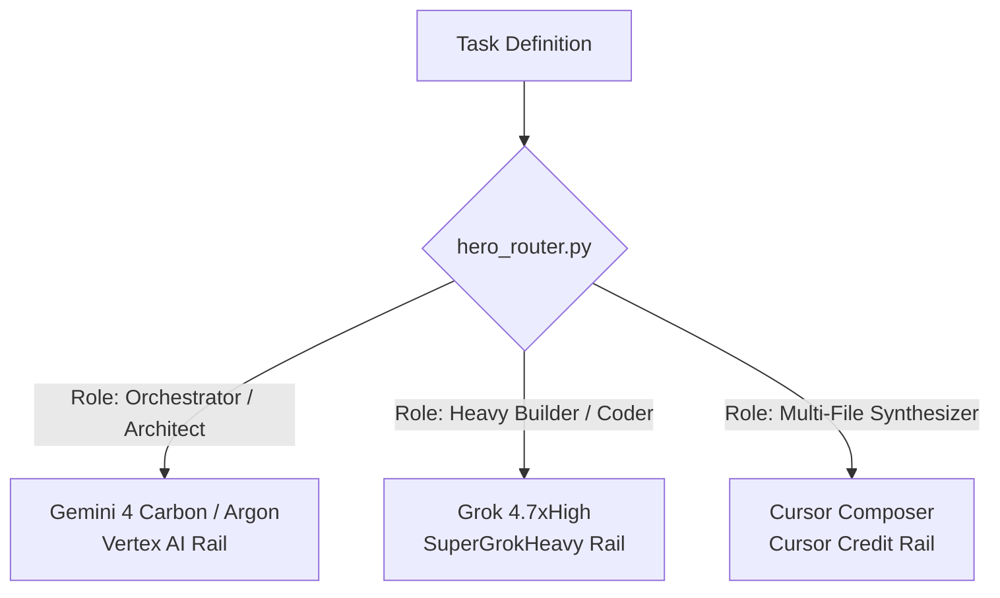
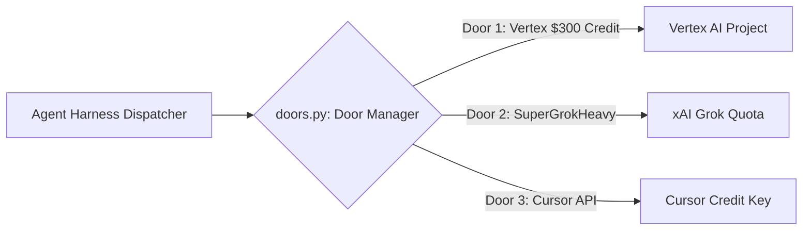
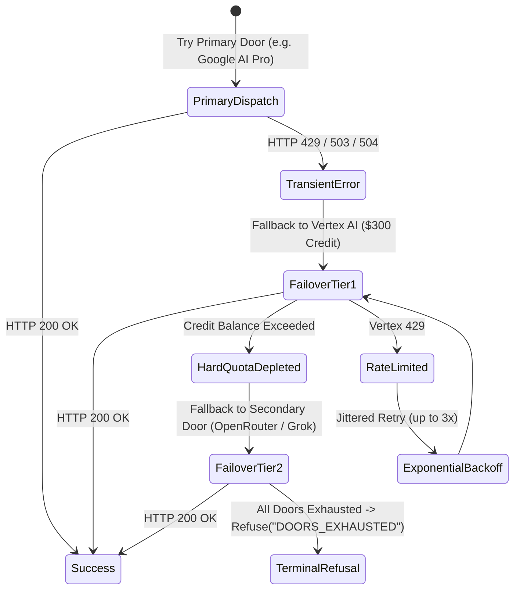

# Chapter 3: Model Routing, Deterministic Failover, and Door Allocation

**Part of the textbook:** [Frontier Agent Harnesses (2024–2026)](README.md)  
**Research & Writing:** Team 3 (Routing, Quotas & Hardware Door Allocation)  
**Lead Author:** Gemini 4 Carbon (Orc3)  
**Contributors:** Grok 4.7xHigh Builders (T3-B1..B4), Gemini 4 Carbon Reviewers (T3-R1..R2), Cursor Composer (T3-C1)  
**Anchor Target:** `#chapter-3-harness`

---

## Chapter Overview
In production agent systems, relying on a single model endpoint or API account guarantees fragility: rate limits (HTTP 429), quota exhaustion, transient cloud outages, and long-context pricing surcharges will abruptly crash autonomous runs. 

In this chapter, we explore the harness routing substrate. We formalize **Heterogeneous Model Routing** (`hero_router.py`), examine multi-account quota balancing across provider "Doors" (`doors.py`), detail zero-downtime **Deterministic Failover Chains** (`deterministic_failover.py`), and explain hardware token watermarking enforcing the **Keith 170k / 180k Ceiling Invariant**.

---

## 3.1 Heterogeneous Model Routing: Dynamic SKU Matching (`hero_router.py`)

A defining trend of 2024–2026 is the abandonment of the "one model fits all" approach. Different foundation models possess distinct operational advantages, pricing structures, and reasoning traits:
- **High-Capacity Planning & Orchestration:** Gemini 4 Carbon / Argon (deep context reasoning, low latency, structured JSON reliability).
- **High-Volume Raw Code Generation:** Grok 4.7xHigh (unmatched raw programming speed and compiler navigation under high-concurrency quotas).
- **Multi-File Integration & IDE Context:** Cursor Composer / Claude Opus (nuanced patch editing across complex multi-file AST trees).

### 3.1.1 The Hero Router Pattern
The harness router (`hero_router.py`) dynamically maps task intent to the optimal model SKU based on task family, token budget, and active door health:



```python
# From cosmos_harness.hero_router
def route_hero_task(task_spec: TaskSpec, quota_state: QuotaState) -> ModelRoute:
    if task_spec.role in ("pilot", "orc", "architect"):
        # Direct to Google Cloud Vertex AI rail
        return ModelRoute(model_sku="gemini-4-carbon", door_id="vertex-medicineman")
    elif task_spec.role == "builder":
        # Check Grok token ceiling before dispatch
        if quota_state.grok_input_tokens >= 170000:
            return ModelRoute(model_sku="gemini-4-carbon", door_id="vertex-medicineman", flag="FALLBACK")
        return ModelRoute(model_sku="grok-4.7", door_id="xai-supergrok")
    elif task_spec.role == "composer":
        return ModelRoute(model_sku="claude-opus-5-5", door_id="cursor-credits")
    raise Refuse("UNKNOWN_ROLE", f"No hero route for role {task_spec.role}")
```

---

## 3.2 Door Allocation & Account Balancing (`doors.py`)

In the COSMOS harness architecture, external AI endpoints are abstracted as **Doors**. A Door encapsulates:
1. Target API URL (`https://api.cursor.com`, `aiplatform.googleapis.com`, `api.x.ai/v1`).
2. Authentication credential reference (stored safely in `<secrets-store>/.env` or key files, never hardcoded).
3. Concurrency limit (maximum active in-flight requests permitted).
4. Spend accumulator and credit tracking balance.



### 3.2.1 Door Capacity Throttling (`doorcap.py`)
To prevent hitting cloud provider rate limits:
- The harness maintains an atomic in-flight counter per door.
- When concurrent requests reach the door's capacity limit (e.g., 5 concurrent calls on Vertex AI or 10 on Grok), incoming tasks are queued in memory rather than dispatched to the provider.
- This eliminates the burst-induced HTTP 429 errors that plague naive multi-agent scripts.

---

## 3.3 Deterministic Failover Chains (`deterministic_failover.py`)

Cloud API endpoints experience transient errors, network drops, and unexpected quota throttling. In an autonomous multi-hour run, a single unhandled exception crashes the entire agent cluster.

### 3.3.1 The Failover Hierarchy
The harness implements a **Deterministic Failover State Machine**:



### 3.3.2 Zero-Downtime Context Preservation
During failover, the harness ensures that context is never lost:
- The serialized prompt, active tool declarations, and sandbox git worktree state are preserved in the execution state machine.
- The new door receives the identical input state, resuming execution without rolling back completed sub-tasks.

---

## 3.4 Token Surcharge Defenses: The Keith 170k / 180k Ceiling Invariant

As explored in Volume 1, Chapter 3, provider pricing structures impose steep financial penalties when context windows cross the 200,000-token boundary (e.g. xAI's 2× surcharge wall). 

In the harness layer, the **Context Governor** (`size.py`, `carried.py`) enforces this boundary at the hardware watermark level:

$$\text{Action}(\text{TokenCount}) = \begin{cases} 
\text{DISPATCH\_NORMAL} & \text{if } \text{Tokens} < 170{,}000 \\
\text{TRIGGER\_RESESSION} & \text{if } 170{,}000 \le \text{Tokens} \le 180{,}000 \\
\text{HARD\_TERMINATE} & \text{if } \text{Tokens} > 180{,}000
\end{cases}$$

```python
# From cosmos_harness.size: Hardware Token Watermark Guard
def check_token_watermark(usage: TokenUsage) -> str:
    total_in = usage.prompt_tokens + usage.cached_read_tokens
    if total_in > 180000:
        # Hardware-enforced kill switch: protect 200k 2x surcharge wall
        raise Refuse(
            "TOKEN_CEILING_BREACH",
            f"Hardware watermark exceeded: {total_in} > 180,000 tokens. "
            f"Surcharge wall protection activated."
        )
    elif total_in >= 170000:
        return "RESESSION_MANDATORY"
    return "OK"
```

By enforcing this invariant inside the harness tool execution pipeline, rogue agents that attempt to issue massive file reads during closing turns are intercepted before issuing the next network call.

---

## 3.5 Real-Time Spend Metering (`spend.py`, `meter.py`)

To provide financial governance, the harness records the exact cost of every inference call:
- Queries model-specific input/output pricing matrices.
- Accounts for discounted cached read tokens vs. uncached prompt tokens.
- Accumulates total spend per task, per cluster, and per project in local LMDB storage (`csm_lmdb_schema.py`).
- Enforces user-defined spending allowances (`allowance.py`): if a cluster's cumulative spend reaches its pre-allocated budget cap, the harness gracefully pauses execution and prompts for authorization.

---

## Section Summary & Cross References
- **Harness Anatomy:** For the core subsystems that consume routed model outputs, see [Chapter 1: Anatomy of an Agent Harness](01_CHAPTER_1_HARNESS_FOUNDATIONS_AND_ARCHITECTURE.md).
- **Workspace Sandboxing:** For how routed builders execute within isolated worktrees, see [Chapter 2: Workspace Containment, Sandboxing, and Jail Architectures](02_CHAPTER_2_SANDBOXING_CONTAINMENT_AND_WORKSPACES.md).
- **Ground Truth Oracles:** For how routed agents are evaluated by deterministic test suites, see [Chapter 4: Evaluation Harnesses, Benchmarks, and Oracle Verification](04_CHAPTER_4_EVALUATION_ORACLES_AND_GROUND_TRUTH.md).
