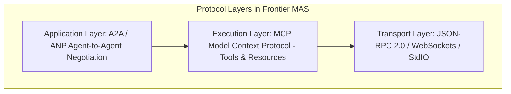
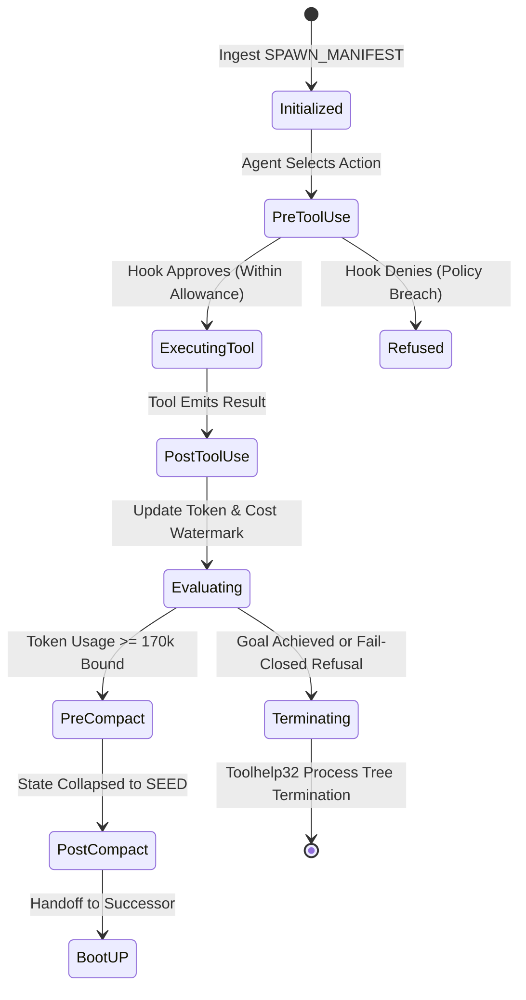

# Chapter 1: Foundations and Evolutionary Architecture of Frontier Multi-Agent Systems

**Part of the textbook:** [Frontier Multi-Agent Systems (2024–2026)](README.md)  
**Research & Writing:** Team 1 (Harness, Lifecycle & Agent Governance)  
**Lead Author:** Gemini 4 Carbon (Orc1)  
**Contributors:** Grok 4.7xHigh Builders (T1-B1..B4), Gemini 4 Carbon Reviewers (T1-R1..R2), Cursor Composer (T1-C1)  
**Anchor Target:** `#chapter-1`

---

## Chapter Overview
In this chapter, we trace the evolutionary transition from single-agent LLM prompting loops to heterogeneous, multi-tiered autonomous agent architectures between 2024 and 2026. We formalize the structural topologies that govern agent interaction, dissect the emergence of standardized protocol stacks (MCP, A2A, ANP), and introduce the mathematical and algorithmic foundations of deterministic agent lifecycle management.

---

## 1.1 The Shift from Single-Turn Prompting to Autonomous Multi-Agent Topologies

The early era of generative AI (2022–2023) was characterized by monolithic prompt engineering. A single Large Language Model was tasked with simultaneously comprehending instructions, recalling domain knowledge, reasoning across multi-step dependencies, emitting syntactic tool invocations, and critiquing its own output. 

By late 2024, empirical analysis revealed that this monolithic paradigm hits severe, predictable walls:
1. **Cognitive Overload & Attention Dilution:** As prompt length and tool definitions expand, self-attention mechanisms exhibit quadratic degradation in signal-to-noise ratio, leading to the documented *"Lost in the Middle"* syndrome.
2. **Context Window Exhaustion:** Complex software engineering tasks requiring hundreds of file reads, test outputs, and compiler diagnostics rapidly consume context windows, precipitating stochastic forgetting and hallucinations.
3. **Homogeneous Bias Cascades:** When a single model makes an incorrect assumption at Step 1, every subsequent step in its chain of thought reinforces and compounds the original error.

The resolution to these failure modes was the formal decomposition of tasks across **Multi-Agent Systems (MAS)**. By constraining individual agents to bounded scopes, discrete toolsets, and specialized roles, the system transforms a high-entropy reasoning task into a coordinated network of modular state transitions.

```
Monolithic Single-Agent (High Entropy):
[ User Prompt + 50 Tool Schemas + 200k Context ] ===> (LLM) ===> Hallucinations / Degradation

Modular Multi-Agent Cluster (Bounded Entropy):
                     [ Orchestrator ]
                     /      |       \
                    v       v        v
          [ Spec Team ] [ Build Team ] [ Review Team ]
             (Tools: A)    (Tools: B)    (Tools: C)
```

---

## 1.2 Structural Topologies: Supervisors, Swarms, Hierarchies, and Lattices

Recent empirical research, notably *MAFBench* (Feb 2026, [arXiv:2602.03128](06_BIBLIOGRAPHY_AND_HYPERLINKED_INDEX.md#ref-mafbench)), demonstrates that **topology choice dictates system throughput and task accuracy far more than the underlying parameter count of individual models**. We classify the four primary coordination topologies:

### 1.2.1 Centralized Hub-and-Spoke (Supervisor)
A single supervisor agent receives external user intent, decomposes it into sub-tasks, dispatches work to satellite workers, and synthesizes the outputs.
- **Coordination Complexity:** $O(N)$ message passes where $N$ is worker count.
- **Vulnerabilities:** The supervisor's context window becomes an operational bottleneck. If the supervisor misinterprets a worker's return payload, the entire task graph stalls.

### 1.2.2 Peer-to-Peer Swarms (Decentralized Dialogue)
Agents operate as autonomous peers communicating across a shared blackboard or message bus (exemplified by early OpenAI Swarm and CAMEL frameworks).
- **Coordination Complexity:** $O(N^2)$ message explosion.
- **Empirical Failure Modes:** Recent research (*The Cost of Consensus*, Apr 2026, [arXiv:2604.xxxxx](06_BIBLIOGRAPHY_AND_HYPERLINKED_INDEX.md#ref-consensus-cost)) demonstrates that unguided peer debate suffers from *sycophantic conformity*, wherein agents abandon correct technical positions to agree with erroneous majorities, yielding lower accuracy than isolated self-correction.

### 1.2.3 Hierarchical Multi-Tiered Clusters (COSMOS / Claude Code Swarm)
To scale beyond 5–10 agents without message explosion or context saturation, production systems adopt the **Hierarchical Cluster** model. Governed by the cognitive fan-out invariant ($7 \pm 1$), an Orchestrator manages at most 5–7 Sub-Orchestrator Team Leads, each of whom manages a team of 5–7 specialized workers (Builders, Reviewers, Composers).
- **Coordination Complexity:** $O(\log N)$ logarithmic scaling.
- **Isolation Guarantees:** Team 1's raw scratchpad tokens and compiler trial-and-error logs never pollute the context window of Team 2 or the Main Orchestrator. Communication occurs strictly through distilled, cryptographic summary payloads ([Chapter 3](03_CHAPTER_3_DURABILITY_AND_VERIFICATION.md)).

### 1.2.4 Dynamic State Lattices (LangGraph)
Coordination is defined as an explicit directed graph where nodes represent agent invocations and edges represent conditional routing functions governed by a shared global state schema.
- **Advantage:** Guarantees deterministic cyclic error-recovery loops.
- **Trade-off:** Requires upfront static graph compilation, reducing spontaneous multi-agent emergent problem-solving.

---

## 1.3 Communication Protocol Stack: MCP, A2A, and ANP

A defining breakthrough of 2024–2026 was the replacement of ad-hoc JSON parsing with formal protocol layers:



### 1.3.1 Model Context Protocol (MCP)
Standardized by Anthropic in late 2024 and adopted across the industry, MCP decouples tool implementation from model execution:
- **Client-Server Architecture:** Agents act as MCP clients connecting to localized or remote MCP servers exposing `resources`, `prompts`, and `tools`.
- **Stateless Tool Discovery:** Models query schemas dynamically at runtime, avoiding prompt bloat from unused tool declarations.

### 1.3.2 Agent-to-Agent (A2A) & Agent Network Protocols (ANP)
Introduced in late 2025 and codified in 2026, A2A protocols standardize multi-agent collaboration:
- **Capability Advertisement:** Agents publish signed capability manifests defining their operational roles, token costs, and trust boundaries.
- **Structured Handoff Handshakes:** Passing structured payloads containing the goal, current state delta, open questions, and cryptographic parent provenance rather than raw conversation histories.

---

## 1.4 Agent Lifecycle State Machines: Pre/Post Hooks and Fail-Closed Exit

In unconstrained environments, agents often loop infinitely or leave orphaned background processes running. Frontier multi-agent engines implement strict **State Machine Lifecycles** governed by pre/post execution hooks.



### 1.4.1 Lifecycle Hooks Specification
Modeled on the Claude Code lifecycle standard and implemented in COSMOS Clusters ([`lifecycle.py`](clusters/lifecycle.py)):
- `PreToolUse`: Fires before tool invocation. Evaluates file boundaries, bash command safety flags (`--dangerously-skip-permissions` forbidden), and spending allowances.
- `PostToolUse`: Fires immediately upon tool completion. Updates token watermarks and validates output integrity before the model ingests the result.
- `PreCompact`: Intercepts context exhaustion prior to unguided trimming, triggering deterministic state collapse.
- `PostCompact`: Verifies that the distilled state payload conforms to schema invariants before resuming execution.

### 1.4.2 Amendment A1: Fail-Closed Process Tree Termination
A critical security flaw identified by Crucible red-teaming in 2026 was the survival of detached subprocesses after agent termination. If a worker spawned a background daemon or file watcher, closing the parent session left orphaned processes mutating disk state.
- **Solution (Crucible Amendment A1):** Full recursive process tree termination via the Windows `Toolhelp32` API / Linux `cgroups.v2` kill mechanism, guaranteeing that when a task session terminates, every spawned child process is halted instantly.

---

## 1.5 Immutable Manifest Injection: The `SPAWN_MANIFEST.json` Standard

To prevent rogue worker behavior and configuration drift, child agents must never be spawned with implicit or inherited ambient permissions. Every worker must receive an immutable, cryptographic `SPAWN_MANIFEST.json` in its sandbox directory ([`manifest.py`](clusters/manifest.py)):

```json
{
  "cluster_id": "cluster-gamma-01",
  "agent_id": "grok-builder-04",
  "role": "worker",
  "parent_id": "gemini-lead-01",
  "cosmos_root": "<cosmos-root>",
  "sandbox_path": "./worktrees/sandbox_task_441",
  "write_file": "clusters/lifecycle.py",
  "seed_path": "./worktrees/sandbox_task_441/SEED.json",
  "close_verb": "cosmos clusters tidyup",
  "limits": {
    "max_turns": 8,
    "max_tokens_in": 170000,
    "max_tokens_out": 8192,
    "timeout_seconds": 600,
    "failure_budget": 2
  }
}
```

### Invariants Enforced by Manifest:
1. **Role Gating:** Child workers cannot promote themselves to orchestrators or claim cluster pens.
2. **Explicit Write Target:** The worker is authorized to mutate only the declared `write_file`.
3. **Hard Ceiling Bounds:** `max_tokens_in` strictly bounds input tokens to 170,000, enforcing Keith's Hero Resession Canon before hitting surcharge barriers.
4. **Mandatory Close Verb:** The agent cannot exit by silently halting; it must invoke the deterministic close verb (`cosmos clusters tidyup`).

---

## 1.6 Case Studies & Comparative Architecture (2024–2026)

| Platform | Coordination Topology | Concurrency Model | Lifecycle Enforcement | Memory Retention |
|---|---|---|---|---|
| **Claude Code Swarm** | Hierarchical Multi-Agent | Ephemeral Sub-agents | Native Pre/Post Hooks | Context Compaction + Memory Files |
| **OpenAI Swarm / Operator** | Decentralized Handoffs | Sequential Single-Thread | Lightweight Function Handoffs | Ephemeral Turn Context |
| **Microsoft AutoGen 0.4** | Event-Driven Actor Graph | Asynchronous Message Bus | Actor State Invariants | Vector Database + Semantic Store |
| **LangGraph Multi-Agent** | Cyclic Directed State Graph | Branching Reducers | Graph Checkpoint Interceptors | Thread-Scoped State Dictionaries |
| **COSMOS Clusters v0.2.0** | Hierarchical Cluster (6+1) | Single-Writer PIN + Worktree CAS | 4-Phase Durability + Toolhelp32 | 5-Hash DoneBundle + Dual WORM 2PC |

### Architectural Insights from Field Deployments:
- **The Pitfall of Pure Decentralization:** Systems relying on unguided peer negotiation (e.g. multi-agent chat rooms) experience high token churn with low task convergence rates on rigorous coding tasks.
- **The Superiority of Hierarchical Specialization:** Topologies separating planning (Orchestrators on Gemini 4 Carbon), implementation (Builders on Grok 4.7), and synthesis (Composers on Cursor) achieve optimal cost-per-pass curves while respecting operational quota limits.

---

## Section Summary & Cross References
- **Single-Writer Concurrency:** For details on how workers mutate state safely without corrupting the live tree, see [Chapter 2: Concurrency Control, Sandbox Isolation, and State Convergence](02_CHAPTER_2_CONCURRENCY_AND_ISOLATION.md).
- **Durability & Token Ceilings:** For the mathematical derivation of the 170k/180k hero resession rule and 4-phase collapse, see [Chapter 3: Agent Durability, Memory Compression, and Cryptographic Attestation](03_CHAPTER_3_DURABILITY_AND_VERIFICATION.md).
- **Chaos Fuzzing:** For adversarial verification of lifecycle hooks, see [Chapter 5: Adversarial Resilience, Security Governance, and Red-Teaming](05_CHAPTER_5_ADVERSARIAL_RESILIENCE_AND_CRUCIBLE.md).
