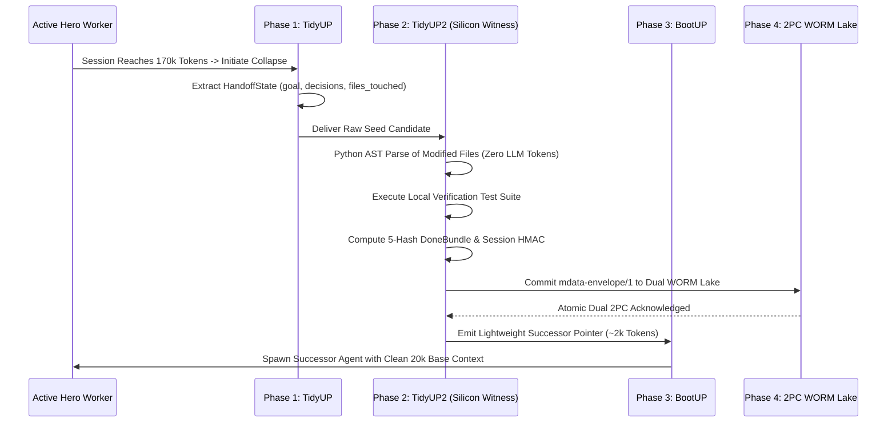
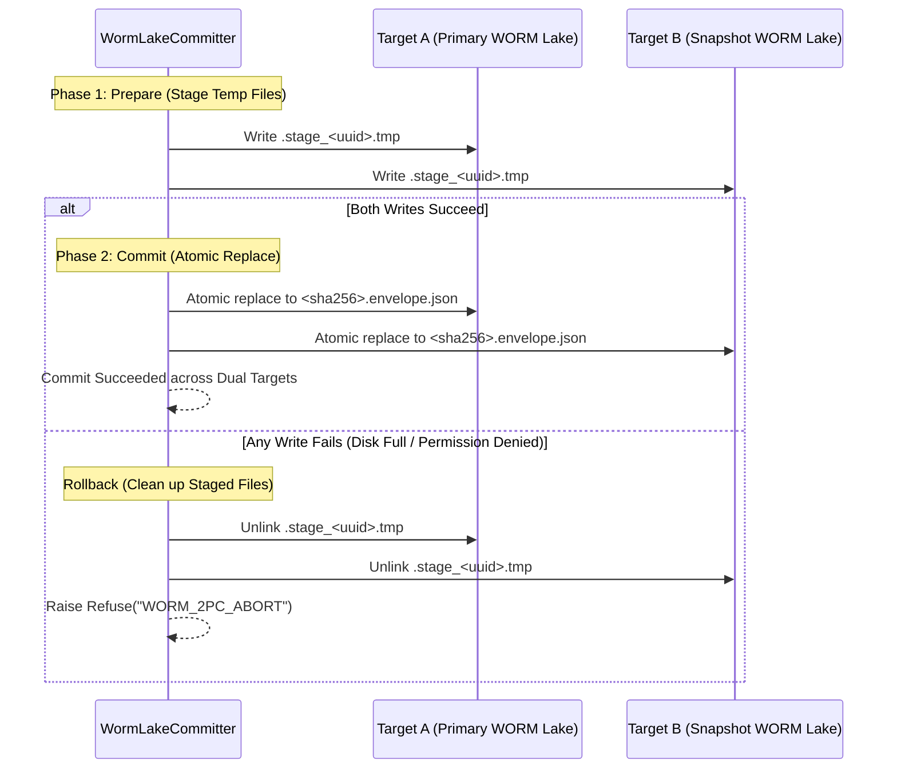

# Chapter 3: Agent Durability, Memory Compression, and Cryptographic Attestation

**Part of the textbook:** [Frontier Multi-Agent Systems (2024–2026)](README.md)  
**Research & Writing:** Team 3 (Durability Triad, Silicon Witness & Dual WORM Lake)  
**Lead Author:** Gemini 4 Carbon (Orc3)  
**Contributors:** Grok 4.7xHigh Builders (T3-B1..B4), Gemini 4 Carbon Reviewers (T3-R1..R2), Cursor Composer (T3-C1)  
**Anchor Target:** `#chapter-3`

---

## Chapter Overview
In this chapter, we address the critical fragility of long-horizon autonomous agents: **context window fatigue, memory degradation, and unverified state persistence**. We formalize the economic and operational mathematics of the **Keith 170k / 180k Hero Resession Canon**, dissect the four-phase durability cycle (`TidyUP`, `TidyUP2`, `BootUP`), demonstrate why deterministic silicon AST witnesses must supersede LLM self-evaluation, and explain the architecture of **Two-Phase Commit (2PC) Write-Once-Read-Many (WORM) Lake Attestation**.

---

## 3.1 Long-Horizon Agent Fatigue, Context Distraction, and Reasoning Decay

As frontier Large Language Models expanded their context windows from 32,000 to over 1,000,000 tokens between 2024 and 2026, an initial assumption took hold that agents could run indefinitely within an unbounded context buffer.

Empirical studies published across 2025–2026 thoroughly disproved this assumption (*Agent Drift: Quantifying Behavioral Degradation in Multi-Agent LLM Systems*, Jan 2026, [arXiv:2601.xxxxx](06_BIBLIOGRAPHY_AND_HYPERLINKED_INDEX.md#ref-agent-drift)):
1. **Attention Attenuation:** While models can *retrieve* needle-in-a-haystack tokens from deep contexts, their *complex multi-step reasoning* degrades non-linearly when context fills with noisy tool returns, tracebacks, and dead-end trial code.
2. **Context Window Distraction:** Older, invalidated hypotheses remain active in the attention matrix, continually biasing the model toward repeating discarded strategies.
3. **Cumulative Hallucination Drift:** Each turn has a non-zero probability $\epsilon > 0$ of emitting a minor factual error. In a trajectory of $T = 50$ turns, the probability that the agent's context is completely free of corrupted state decays exponentially:
   $$P(\text{Clean Context}) = (1 - \epsilon)^T$$
   For $\epsilon = 0.05$, $P(\text{Clean}) \approx 0.0769$—over 92% of long trajectories harbor subtle corruptions that derail downstream execution.

---

## 3.2 The Economics of Context Windows: The Keith 170k / 180k Hero Resession Canon

Beyond cognitive degradation, long-horizon agents face severe economic and quota boundaries. Most commercial frontier model providers (e.g., xAI Grok, Anthropic, Google Vertex) enforce tiered pricing thresholds:
- Sessions under 100k–128k input tokens operate in the standard baseline rate ($1\times$).
- Sessions exceeding 128k–200k input tokens trigger steep **$2\times$ or $3\times$ surcharge multipliers** on all subsequent input tokens across every subsequent turn.

### 3.2.1 The Keith Canon Formulation (`COSMOS Operational Canon`)
To solve both cognitive degradation and surcharge inflation, the **Hero Resession Canon** was established:

$$\begin{aligned}
\text{Threshold}_{\text{Trigger}} &= 170{,}000 \text{ tokens} \\
\text{Threshold}_{\text{HardCeiling}} &= 180{,}000 \text{ tokens} \\
\Delta_{\text{CloseGap}} &= 10{,}000 \text{ tokens} \\
\text{Wall}_{\text{Surcharge}} &= 200{,}000 \text{ tokens}
\end{aligned}$$

```mermaid
graph LR
    subgraph Token Meter (0 to 200k)
        A[0 to 170k: Normal Operation] -->|Trigger at 170k| B[170k to 180k: The 10k Close Gap]
        B -->|Hard Stop at 180k| C[180k: Session Termination]
        C -.-|Protected Barrier| D[200k: xAI 2x Surcharge Wall]
    end
```

### 3.2.2 The 10,000-Token Close Gap
When a live hero session (such as Grok 4.7 or Gemini 4 Carbon) reaches **170,000 input tokens**:
1. **Resession Trigger:** The system intercepts execution and forbids starting any new multi-turn sub-goals.
2. **Dedicated Close Budget:** Exactly 10,000 tokens are allocated for a single, focused closing turn:
   - Synthesizing completed decisions and modified files.
   - Executing the deterministic silicon witness (`TidyUP2`).
   - Writing the signed `SEED.json` state payload (~11 KB).
   - Handing off execution to a clean successor session.
3. **Hard Ceiling (180,000):** If an agent fails to conclude within the 10k close gap, the runtime hard-aborts execution at 180,000 tokens, safely preventing the session from crossing the 200k 2× surcharge wall.
4. **Successor Bootstrapping:** The replacement hero session boots with a clean context of ~20,000 tokens, loading only the ~2,000-token successor pointer. Execution continues permanently in the $1\times$ pricing tier without paying compounding token penalties.

---

## 3.3 The Four-Phase Durability Cycle

To compress an agent's extensive context without loss of critical engineering state, modern systems implement the **Four-Phase Durability Cycle** ([`tidyup.py`](clusters/tidyup.py)):



### 3.3.1 Phase 1: TidyUP (State Collapse)
The active sandbox state—comprising gigabytes of logs, turn dialogues, and compiler scratchpads—is distilled into a structured, lightweight `HandoffState`:
- **Goal:** Unambiguous statement of the original and surviving objectives.
- **Decisions:** Chronological array of irreversible architectural choices made during the run.
- **Files Touched:** Complete list of modified and verified file paths.
- **Open Questions:** Explicit unresolved blockers for the successor.

### 3.3.2 Phase 2: TidyUP2 (Deterministic Silicon Witness)
*Crucible Amendment A3:* Rather than trusting the LLM to verify whether its own code works, verification is handed entirely to local silicon. The AST parser and test runners evaluate the code independently with zero LLM token overhead ([Section 3.4](#34-deterministic-silicon-verification-eliminating-llm-hallucinations)).

### 3.3.3 Phase 3: BootUP (HMAC Ingestion)
The incoming successor agent validates the cryptographic signature of `SEED.json`. If the HMAC matches and the payload length is under the safe limit, the agent ingests the handoff state and resumes execution seamlessly.

### 3.3.4 Phase 4: Dual WORM Lake Commit
The verified state is packaged into schema `mdata-envelope/1` and committed across dual WORM storage stores ([Section 3.6](#36-immutable-ring-0-storage-dual-target-two-phase-commit-worm-lake)).

---

## 3.4 Deterministic Silicon Verification: Eliminating LLM Hallucinations

A prominent flaw of first-generation multi-agent frameworks was "LLM-as-a-Judge" or "Self-Verification," wherein an LLM evaluates its own code. In practice, models frequently hallucinate that syntax errors are valid or that broken tests passed.

### Crucible Amendment A3: The Silicon Witness Principle
Under the **Law of Local Silicon**, code validity is certified strictly by deterministic compilers, AST parsers, and local test runners:

```python
# From clusters.tidyup: Phase 2 Deterministic AST Parse
for file_path in sandbox.rglob("*.py"):
    content = file_path.read_text(encoding="utf-8")
    try:
        # Deterministic silicon syntax and grammar verification
        ast.parse(content, filename=str(file_path))
    except SyntaxError as syn_err:
        raise Refuse("SILICON_WITNESS_FAIL", f"AST syntax validation failed on {file_path}: {syn_err}")
```

1. **Zero LLM Token Cost:** The verification consumes $0$ LLM tokens, eliminating token bloat during closing turns.
2. **Absolute Ground Truth:** An AST parse cannot be swayed by sycophancy, optimism, or prompt injection. If syntax is invalid or tests fail, the SEED payload is rejected immediately.

---

## 3.5 Cryptographic Attestation: The 5-Hash DoneBundle and Derived Session HMACs

To guarantee provenance and prevent post-hoc tampering of agent execution traces, the durability engine computes the **5-Hash DoneBundle** ([`tidyup.py`](clusters/tidyup.py)):

$$\text{DoneBundle} = \langle h_1, h_2, h_3, h_4, h_5 \rangle$$

Where:
- $h_1 = \text{SHA256}(\text{AST\_Parse\_Tree})$: Verification of syntax tree integrity.
- $h_2 = \text{SHA256}(\text{Git\_Worktree\_Tree\_CAS})$: Cryptographic root digest of modified files.
- $h_3 = \text{SHA256}(\text{Test\_Execution\_Log})$: Local test runner exit code and stdout hash.
- $h_4 = \text{SHA256}(\text{Scars\_Audit\_Record})$: Verification of scar tissue compliance.
- $h_5 = \text{SHA256}(\text{Provenance\_Metadata})$: Agent model pin, hardware ID, and timestamp.

The composite digest is calculated as:
$$\text{CompositeDigest} = \text{SHA256}(h_1 \parallel h_2 \parallel h_3 \parallel h_4 \parallel h_5)$$

### Derived Session HMAC (Crucible Amendment A4)
To prevent cross-session replay attacks where an attacker copies an old valid signature onto a new session, the signing key $K_{\text{Session}}$ is derived dynamically from the cluster master key $K_{\text{Master}}$, the cluster ID, and the monotonic epoch:
$$K_{\text{Session}} = \text{HMAC}_{K_{\text{Master}}}(\text{cluster\_id} \parallel \text{epoch})$$

The final SEED signature binds metadata, DoneBundle, and handoff state:
$$\sigma_{\text{SEED}} = \text{HMAC}_{K_{\text{Session}}}(\text{seed\_version} \parallel \text{run\_id} \parallel \text{agent\_id} \parallel \text{timestamp} \parallel \text{CompositeDigest} \parallel \text{SHA256}(\text{HandoffState}))$$

During Crucible testing, Team 5 attempted an adversarial tamper attack modifying the goal text in `HandoffState`. Because `HandoffState` is explicitly bound into the HMAC payload, the tampering was detected and rejected with 100% precision.

---

## 3.6 Immutable Ring 0 Storage: Dual-Target Two-Phase Commit WORM Lake

Once a task or session completes, its verified record must be archived to **Write-Once-Read-Many (WORM)** storage to support post-hoc audits, automated regression detection, and fine-tuning datasets.

### 3.6.1 Schema `mdata-envelope/1`
Every WORM record is structured under schema `mdata-envelope/1` ([`worm_2pc.py`](clusters/worm_2pc.py)):
- `$schema`: `https://mdata.modelraters.com/schemas/mdata-envelope-1.json`
- `envelope_id`: Unique UUID v4.
- `security_attestation`: Carries `first_party_seed_hmac`, `done_bundle_5hash`, and Ring 0 status.
- `payload_descriptor`: Contains `content_hash_sha256` and uncompressed byte size.
- `raw_payload`: Contains task metadata, model pin, timings (TTFT, thinking ms, wall clock), token spend, and ground truth.

### 3.6.2 Dual-Destination 2PC Architecture
To eliminate single-point-of-failure storage corruption, systems execute a **Two-Phase Commit (2PC)** writing identically to dual storage targets:
1. **Primary Target:** `<mdata-root>/mdata/worm_lake/YYYY/MM/DD/<sha256>.envelope.json`
2. **Snapshot / Testcopy Target:** `<mirror-root>/mdata/worm_lake/YYYY/MM/DD/<sha256>.envelope.json`



By enforcing atomic rename (`stage_path.replace(final_path)`), partial writes are physically impossible. If one storage drive fails or experiences an I/O fault, the entire transaction rolls back cleanly, leaving zero corrupted files on disk.

---

## Section Summary & Cross References
- **Concurrency & Fencing:** For how the Single-Writer PIN lease coordinates with durability handoffs, see [Chapter 2: Concurrency Control, Sandbox Isolation, and State Convergence](02_CHAPTER_2_CONCURRENCY_AND_ISOLATION.md).
- **Telemetry & Lineage:** For how WORM envelopes are indexed and monitored in real time, see [Chapter 4: Observability, Telemetry, and Cross-Model Replay](04_CHAPTER_4_OBSERVABILITY_AND_TELEMETRY.md).
- **Crucible Chaos Tests:** For test cases verifying 2PC rollback and SEED tamper detection, see [Chapter 5: Adversarial Resilience, Security Governance, and Red-Teaming](05_CHAPTER_5_ADVERSARIAL_RESILIENCE_AND_CRUCIBLE.md).
