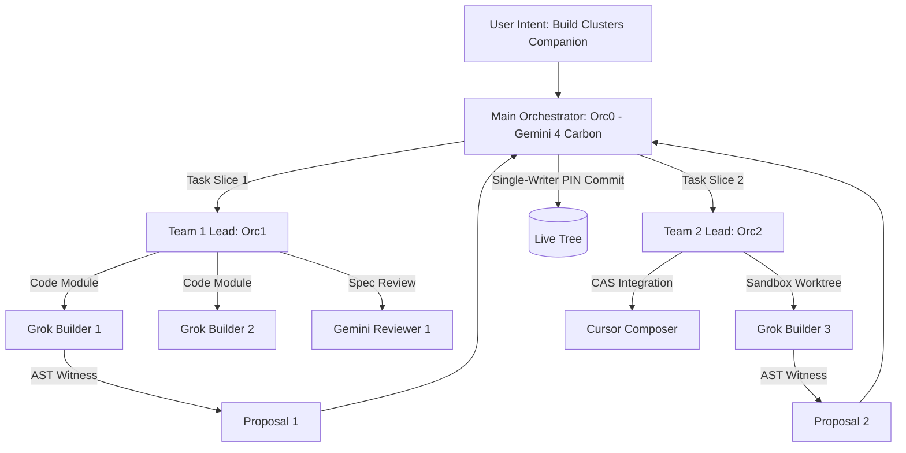

# Chapter 4: Observability, Telemetry, and Cross-Model Replay in Production Multi-Agent Systems

**Part of the textbook:** [Frontier Multi-Agent Systems (2024–2026)](README.md)  
**Research & Writing:** Team 4 (CM Sessions, Replay & cDeck Interactive Dashboard)  
**Lead Author:** Gemini 4 Carbon (Orc4)  
**Contributors:** Grok 4.7xHigh Builders (T4-B1..B4), Gemini 4 Carbon Reviewers (T4-R1..R2), Cursor Composer (T4-C1)  
**Anchor Target:** `#chapter-4`

---

## Chapter Overview
As multi-agent deployments scale across dozens of heterogeneous models, operational teams face an acute **Observability Crisis**. When stochastic agents communicate asynchronously across branching sub-tasks, traditional logging paradigms (e.g., flat stdout logs or basic APM traces) fail to capture root-cause divergence points. 

In this chapter, we formalize the architecture of multi-agent observability. We examine **Reverse-Chronological Delta Scanning** (`cmsessions`) with zero-body filesystem caching, dissect the real-time terminal telemetry engine (**cDeck**), formalize DAG execution lineage tracking, explain deterministic historical session replay, and present **Scar Tissue Auditing** for automated cluster self-healing.

---

## 4.1 The Observability Crisis in Non-Deterministic Multi-Agent Networks

In single-threaded software, errors exhibit clear stack traces pointing to deterministic lines of code. In contrast, multi-agent networks introduce non-deterministic distributed failures:
1. **Cascading Hallucination Drift:** An upstream spec agent emits a slightly ambiguous interface requirement. Three downstream builder agents interpret it differently, generating contradictory code that passes local syntax checks but fails integration at runtime.
2. **Silent Livelocks & Stalls:** Two subagents waiting for mutual review feedback enter an unspoken deadlock, silently burning background API credits without progressing toward the goal.
3. **Black-Box Cost Explosions:** A recursive tool-calling loop triggered by an unhandled compiler warning can burn hundreds of dollars in API credits within minutes if token burn rates are not metered in real time.

Traditional distributed tracing (e.g. OpenTelemetry spans) captures network latency and HTTP status codes, but is blind to **semantic divergence**, **context saturation**, and **agent reasoning drift**. Production multi-agent systems require observability native to LLM state machines.

---

## 4.2 Reverse-Chronological Hot-Set Delta Scanning (`cmsessions`)

In production environments, clusters generate thousands of historical session logs across multiple drives and tools (e.g., `~/.claude/sessions/`, `<clusters-root>/cmsessions/`). Reading every historical session JSON file on every cluster boot creates severe I/O thrashing and memory exhaustion.

### 4.2.1 The 7-Day Hot-Set Delta Invariant
To provide instant startup while maintaining historical awareness, the session scanner ([`cmsessions.py`](clusters/cmsessions.py)) implements **Reverse-Chronological Delta Scanning**:
$$\text{ScanWindow} = \{ s \in \text{Sessions} \mid \text{mtime}(s) \ge \text{now}() - 7 \times 86{,}400 \}$$

```mermaid
graph TD
    subgraph Filesystem Storage (Thousands of Sessions)
        H1[Session: 140 Days Old]
        H2[Session: 30 Days Old]
        H3[Session: 8 Days Old]
        C1[Session: 5 Days Old]
        C2[Session: 2 Days Old]
        C3[Session: 1 Hour Old]
    end

    subgraph Hot-Set Delta Scanner
        M[Stat Cache: Directory mtime Fast Index]
        M -->|Filter: mtime >= now - 7 days| HS[Active 7-Day Hot Set]
    end

    C1 --> HS
    C2 --> HS
    C3 --> HS
    H1 -.->|Zero-Body Skip| M
    H2 -.->|Zero-Body Skip| M
    H3 -.->|Zero-Body Skip| M
```

### 4.2.2 Zero-Body Directory `mtime` Caching
Rather than opening and parsing every `.json` file body to inspect timestamps:
1. The scanner queries the directory entry `mtime` (modified time) via low-level OS file stat operations (`os.scandir`).
2. Sessions outside the 7-day window are skipped without reading file content into memory, achieving an **$O(1)$ memory footprint** during initial scanning.
3. Only sessions within the active 7-day window have their header records parsed into the in-memory cache, enabling sub-second cluster startup across terabytes of historical logs.

---

## 4.3 Production Telemetry: The cDeck Terminal Dashboard

To monitor complex multi-agent execution without introducing heavy web GUI dependencies, systems deploy the **cDeck** terminal dashboard ([`cdeck_dashboard.py`](clusters/cdeck_dashboard.py)):

```
================================================================================
                   COSMOS CLUSTERS - CDECK MONITORING DASHBOARD                
================================================================================
Epoch: 102 | PIN Holder: COSMOS_PILOT_ORCHESTRATOR | Dual WORM Healthy: True
--------------------------------------------------------------------------------
TOKEN CONSUMPTION GAUGE (Keith 170k / 180k Hero Canon):
  Tokens: 42,500 / 180,000 (23.6%) [NORMAL]
--------------------------------------------------------------------------------
ACTIVE CLUSTER TEAMS (40 Agents Across 5 Teams):
  [1] Team 1 (Harness & Lifecycle)           | Lead: Gemini 4 Carbon (Orc1) | [IDLE / READY]
  [2] Team 2 (Worktrees & Single-Writer PIN) | Lead: Gemini 4 Carbon (Orc2) | [RUNNING]
  [3] Team 3 (Durability & Dual WORM 2PC)    | Lead: Gemini 4 Carbon (Orc3) | [VERIFIED]
  [4] Team 4 (CM Sessions & cDeck)           | Lead: Gemini 4 Carbon (Orc4) | [ACTIVE]
  [5] Team 5 (Adversarial Crucible Red Team) | Lead: Gemini 4 Carbon (Orc5) | [MONITORING]
--------------------------------------------------------------------------------
Active Dispatch Path Locks: 1 held
  - clusters/api.py -> task-subagent-patch-001
================================================================================
```

### 4.3.1 Headless Decoupling (Crucible Amendment A5)
A common flaw in agent systems is hard-coupling monitoring logic to GUI browser processes. If the web browser crashes or runs out of memory, the underlying agent execution dies with it.
- **Amendment A5 Invariant:** The telemetry engine must be completely decoupled from GUI runtimes. `cDeck` operates headlessly as a lightweight daemon, outputting structured JSON streams to disk and emitting clean ANSI strings to standard console streams. The cluster operates autonomously even if all user interfaces are disconnected.

---

## 4.4 Trace Lineage & Directed Acyclic Graph Execution Telemetry

In hierarchical clusters, an intent emitted by the user cascades through multiple agent tiers before touching disk:



### Execution Telemetry Metrics Captured:
1. **Time-to-First-Token (TTFT):** Measures agent scheduling and prompt ingestion latency.
2. **Thinking Duration (ms):** Wall-clock time spent in internal reasoning loops (e.g. extended reasoning tokens in Gemini 4 Carbon and Grok 4.7).
3. **Token Utilization Ratio:**
   $$\text{Ratio} = \frac{\text{Prompt Tokens} + \text{Cached Reads}}{\text{Completion Tokens}}$$
4. **Cumulative Spend ($USD):** Real-time aggregation of provider API expenditures across all 40 agent seats.

---

## 4.5 Historical Decision Replay and Divergence Point Analysis

When an agent team produces code that introduces a subtle regression, traditional debugging requires manually parsing thousands of lines of chat transcripts.

### 4.5.1 The Session Replay Engine (`session_replay.py`)
The Replay Engine ([`session_replay.py`](clusters/session_replay.py)) parses archived `mdata-envelope/1` records and serializes structured execution replays:

```python
# From clusters.session_replay
@dataclass
class ReplayTurn:
    index: int
    role: str
    action_type: str
    summary: str
    tokens_used: int
    timestamp: float
    scars_detected: List[str]
```

### 4.5.2 Divergence Point Analysis (Delta Auditing)
By comparing two independent runs of the same task family (e.g. Run A which succeeded vs. Run B which failed), the replay engine identifies the exact turn where reasoning diverged:
1. Computes the cosine similarity of decision vectors across sequential turns.
2. Identifies the first turn where similarity drops below threshold $\tau = 0.85$.
3. Flags the divergence as either:
   - **Tool Output Discrepancy:** External environment or compiler emitted a different result.
   - **Stochastic Branching:** Model selected an alternative reasoning path under non-zero temperature.

---

## 4.6 Scar Tissue Auditing: Automated Self-Healing Knowledge Ingestion

In the COSMOS philosophy, an error encountered during execution is never discarded; it is distilled into **Scar Tissue**—an immutable, permanent post-mortem rule that is injected into future agent prompts to prevent recurring failures.

### 4.6.1 Structure of an Operational Scar Record
When a task fails or triggers an unexpected refusal, the telemetry engine records a scar entry in `SCAR_TISSUE.json`:
- **Scar ID:** Canonical hash identifier (e.g., `SCAR_BTS_DUAL_WRITER_01`, `SCAR_HMAC_TAMPER_02`).
- **Trigger Condition:** The specific multi-agent condition that precipitated the failure (e.g., "Concurrent writes to same file without dispatch lock").
- **Constitutional Invariant:** The binding rule created to prevent recurrence (e.g., "Amendment A2: Must claim upfront dispatch lock before worktree creation").
- **Silicon Test Case:** Permanent unit test added to the Crucible test battery to continuously verify that the vulnerability remains patched.

Through continuous scar tissue auditing, the multi-agent cluster exhibits **monotonic self-healing**: the system grows more resilient with every failed run.

---

## Section Summary & Cross References
- **Lifecycle Hooks:** For details on how telemetry hooks intercept tool invocations, see [Chapter 1: Foundations and Evolutionary Architecture](01_CHAPTER_1_FOUNDATIONS_AND_LIFECYCLES.md).
- **Durability & 2PC Envelopes:** For the schema specification of the `mdata-envelope/1` records parsed by the replay engine, see [Chapter 3: Agent Durability, Memory Compression, and Cryptographic Attestation](03_CHAPTER_3_DURABILITY_AND_VERIFICATION.md).
- **Adversarial Chaos Fuzzing:** For how telemetry monitors detect attacks in real time, see [Chapter 5: Adversarial Resilience, Security Governance, and Red-Teaming](05_CHAPTER_5_ADVERSARIAL_RESILIENCE_AND_CRUCIBLE.md).
